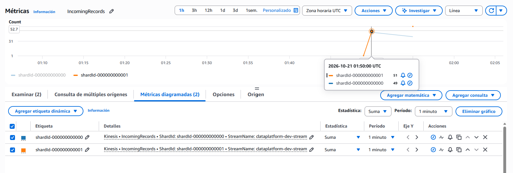

# Data Platform en AWS con Terraform

Plataforma de datos en AWS gestionada 100% con Terraform. Se construye por etapas:

| Entrega | Alcance | Sección |
|---|---|---|
| Pre-entrega 1 | Backend remoto con locking, VPC de datos privada con acceso a S3 por la red interna de AWS, bucket de Data Lake y roles IAM | [Infraestructura base](#arquitectura) |
| Pre-entrega 2 | Ingesta real-time: Kinesis Data Stream (provisioned, KMS), Firehose hacia la capa Bronze del Data Lake, producer simulado y alarmas | [Ingesta real-time](#pre-entrega-2--ingesta-real-time-sobre-el-entorno-base) |

## Arquitectura

```
                         ┌──────────────────────────── Cuenta AWS (us-east-1) ────────────────────────────┐
                         │                                                                                │
 terraform (CLI / CI) ──►│  bootstrap/                                                                    │
                         │   ├─ S3  dataplatform-tfstate-<account>   (state: SSE, versionado, sin público) │
                         │   └─ DynamoDB  dataplatform-tf-locks      (state locking)                       │
                         │                                                                                │
                         │  environments/dev/                                                             │
                         │   ├─ module.network                                                            │
                         │   │    VPC 10.20.0.0/16 ─┬─ subred privada AZ-a 10.20.10.0/24                  │
                         │   │                      └─ subred privada AZ-b 10.20.11.0/24                  │
                         │   │    tabla de rutas privada: local + S3 Gateway Endpoint (sin IGW / NAT)     │
                         │   ├─ module.storage                                                            │
                         │   │    S3 dataplatform-dev-datalake-<account>  (objetos solo vía VPC Endpoint) │
                         │   ├─ module.identity                                                           │
                         │   │    rol ingest-exec  (Lambda: List/Get/Put sobre raw/)                      │
                         │   │    rol auditor      (solo lectura de configuración, requiere MFA)          │
                         │   └─ module.kinesis   (pre-entrega 2)                                          │
                         │        Kinesis Data Stream ─► Firehose ─► S3 Data Lake raw/ingesta/            │
                         └────────────────────────────────────────────────────────────────────────────────┘
```

Flujo de outputs entre módulos (sin IDs ni ARNs hardcodeados):

```
network.s3_endpoint_id ──► storage.allowed_vpce_id
storage.bucket_arn / data_prefix ──► identity.data_bucket_arn / data_prefix
storage.bucket_arn / data_prefix ──► kinesis.data_lake_bucket_arn / bronze_prefix
local.firehose_role_name / _arn  ──► kinesis.firehose_role_name + storage.vpce_exempt_principal_arns
network.vpc_id, private_subnet_ids, identity.*_role_arn ──► outputs del entorno ──► próxima pre-entrega
```

## Estructura del repositorio

```
.
├── bootstrap/                 # Root module 1: crea el backend (bucket de state + tabla de locks)
│   ├── main.tf
│   ├── variables.tf
│   ├── outputs.tf
│   └── backend.hcl.example    # plantilla de configuración del backend (backend.hcl no se versiona)
├── modules/                   # Módulos reutilizables: no conocen el entorno, todo entra por variables
│   ├── network/               # VPC, subredes privadas, tabla de rutas, S3 Gateway Endpoint
│   ├── storage/               # Bucket del Data Lake con hardening
│   ├── identity/              # Rol de ejecución y rol de auditoría
│   └── kinesis/               # Pre-entrega 2: Kinesis Data Stream + Firehose → S3, IAM y alarmas
├── environments/
│   └── dev/                   # Root module 2: invoca los módulos con los valores de dev
│       ├── backend.tf         # backend "s3" {} (configuración parcial)
│       ├── providers.tf       # versiones + provider AWS con default_tags
│       ├── main.tf            # llamadas a los módulos
│       ├── variables.tf       # environment, region, vpc_cidr, project_name (tipadas y validadas)
│       ├── terraform.tfvars   # valores de dev
│       ├── outputs.tf
│       └── backend.hcl.example
├── scripts/                   # producer simulado (Python/Boto3) y evento de prueba para la CLI
├── docs/                      # capturas de verificación
├── PLAN_OUTPUT.md
└── README.md
```

**Por qué esta separación:** los módulos son "recetas" y los entornos son quienes las usan. `modules/network` no sabe si corre en dev o en prod; solo `environments/dev/` contiene valores propios del entorno. Agregar prod es crear `environments/prod/` con otro `terraform.tfvars` y otro backend, sin tocar los módulos.

## Requisitos

- Terraform >= 1.5
- AWS CLI v2 configurada con un **usuario IAM** (nunca el usuario root): `aws configure` y verificar con `aws sts get-caller-identity`
- Permisos para crear S3, DynamoDB, VPC e IAM en la cuenta (y, desde la pre-entrega 2, Kinesis, Firehose, KMS y CloudWatch)
- Python 3 con `boto3` para el producer simulado (pre-entrega 2)

## Despliegue paso a paso

### 1. Bootstrap del backend (una sola vez)

El backend no puede crearse desde el mismo proyecto que lo usa (Terraform necesita el bucket para guardar su state), por eso vive en un root module separado.

```bash
cd bootstrap
terraform init
terraform apply            # crea el bucket de state y la tabla de locks
```

Luego se migra el state del propio bootstrap al bucket recién creado:

```bash
cp backend.hcl.example backend.hcl    # completar <ACCOUNT_ID>
terraform init -backend-config="backend.hcl" -migrate-state   # responder "yes"
terraform plan                                                # debe decir "No changes"
```

### 2. Entorno dev

```bash
cd ../environments/dev
cp backend.hcl.example backend.hcl    # completar <ACCOUNT_ID>
terraform init -backend-config="backend.hcl"
terraform validate
terraform plan
terraform apply
```

> **Configuración parcial del backend:** el bloque `backend` no admite variables, por lo que los valores concretos (bucket con el ID de cuenta, key, tabla) viven en `backend.hcl`, que está en `.gitignore`. El repositorio solo incluye `backend.hcl.example`.

## Recursos creados

| Root module | Recurso | Propósito |
|---|---|---|
| bootstrap | S3 `dataplatform-tfstate-<account>` | State remoto. Versionado, SSE (AES256), Block Public Access, solo HTTPS, `prevent_destroy` |
| bootstrap | DynamoDB `dataplatform-tf-locks` | State locking (`LockID`), on-demand, PITR y cifrado |
| dev / network | VPC `10.20.0.0/16` | Red de datos con DNS habilitado |
| dev / network | 2 subredes privadas (2 AZs) | Cómputo futuro (Lambda/Flink); sin IP pública |
| dev / network | Tabla de rutas privada | Solo ruta local + S3; **sin Internet Gateway ni NAT** |
| dev / network | S3 Gateway Endpoint | Acceso a S3 por la red de AWS: sin NAT, sin costo, baja latencia |
| dev / network | Security group por defecto sin reglas | Nada lanzado "por defecto" queda expuesto |
| dev / storage | S3 `dataplatform-dev-datalake-<account>` | Data Lake. Versionado, SSE, Block Public Access, solo HTTPS, objetos solo vía VPC Endpoint |
| dev / identity | Rol `dataplatform-dev-ingest-exec` | Rol de ejecución para Lambda |
| dev / identity | Rol `dataplatform-dev-auditor` | Rol de auditoría de solo lectura |

### Verificación del Gateway Endpoint

La asociación con las subredes privadas se verifica en **VPC → Tablas de rutas → `dataplatform-dev-private-rt`**: la pestaña *Rutas* muestra la prefix list de S3 (`pl-…`) con destino al endpoint (`vpce-…`), y la pestaña *Asociaciones de subred* muestra ambas subredes privadas.


## Diseño IAM (mínimo privilegio)

### Rol de ejecución — `dataplatform-dev-ingest-exec`

- **Trust policy:** solo `lambda.amazonaws.com`, con condición `aws:SourceAccount` igual a la cuenta (previene *confused deputy*).
- **Permisos (únicamente los tres que pide la consigna, sobre un prefijo):**

| Acción | Recurso | Cómo se acota |
|---|---|---|
| `s3:ListBucket` | ARN del bucket del Data Lake | Condición `s3:prefix` = `raw/`, `raw/*` |
| `s3:GetObject`, `s3:PutObject` | `arn:aws:s3:::<datalake>/raw/*` | Prefijo en el ARN |

- No tiene acceso al bucket del state ni a otros prefijos. No puede borrar objetos ni crear o modificar recursos.
- Política administrada (`aws_iam_policy` + attachment), no inline, para versionarla y auditarla de forma independiente.

### Rol de auditoría — `dataplatform-dev-auditor`

- **Trust policy:** identidades de la propia cuenta, **solo con MFA** (`aws:MultiFactorAuthPresent = true`).
- **Permisos de solo lectura de configuración**, nunca de datos:

| Ámbito | Acciones | Recurso |
|---|---|---|
| Red | `ec2:DescribeVpcs`, `DescribeSubnets`, `DescribeRouteTables`, `DescribeVpcEndpoints`, `DescribeSecurityGroups` | `*` acotado por `aws:RequestedRegion` (ver nota) |
| Buckets | `s3:GetBucketPolicy`, `GetBucketVersioning`, `GetEncryptionConfiguration`, `GetBucketPublicAccessBlock`, `GetBucketTagging`, `GetBucketLocation` | Bucket del Data Lake y bucket del state |
| Locking | `dynamodb:DescribeTable` | Tabla de locks |
| IAM | `iam:GetRole`, `ListAttachedRolePolicies`, `ListRolePolicies`, `GetPolicy`, `GetPolicyVersion`, `ListPolicyVersions` | Roles y políticas con prefijo `dataplatform-dev-*` |

> **Nota sobre `*`:** las acciones `ec2:Describe*` no admiten permisos a nivel de recurso en AWS; es la única excepción y corresponde a acciones de **solo lectura**, restringidas además a la región del entorno. Ninguna acción de escritura usa `Resource: "*"`. El auditor no tiene `s3:GetObject` ni `s3:ListBucket`: verifica configuración, no lee datos.

## Outputs del entorno dev

| Output | Descripción |
|---|---|
| `vpc_id` | ID de la VPC de datos |
| `private_subnet_ids` | IDs de las subredes privadas |
| `s3_endpoint_id` | ID del S3 Gateway Endpoint |
| `data_lake_bucket_name` | Bucket del Data Lake |
| `exec_role_arn` | ARN del rol de ejecución |
| `audit_role_arn` | ARN del rol de auditoría |
| `kinesis_stream_name` | Nombre del Kinesis Data Stream (pre-entrega 2) |
| `kinesis_shard_count` | Cantidad de shards calculada (pre-entrega 2) |
| `firehose_name` | Nombre del delivery stream de Firehose (pre-entrega 2) |
| `bronze_s3_prefix` | Prefijo de S3 donde Firehose entrega los datos crudos (pre-entrega 2) |

```bash
cd environments/dev
terraform output
```

## Pre-entrega 2 — Ingesta real-time sobre el entorno base

Se agrega el módulo `modules/kinesis` al entorno dev. Reutiliza el Data Lake y la convención de nombres de la pre-entrega 1.

### Arquitectura de ingesta

```
 producer.py / AWS CLI
   (PartitionKey = user_id)
          │  PutRecords
          ▼
 ┌──────────────────────────────────────┐
 │ Kinesis Data Stream                  │   PROVISIONED · 2 shards · cifrado KMS (CMK)
 │ dataplatform-dev-stream              │   métricas por shard + alarmas Read/Write throughput
 │  ├─ shard 0                          │
 │  └─ shard 1                          │
 └──────────────────┬───────────────────┘
                    │  consumidor: Firehose (rol dataplatform-dev-firehose-role)
                    ▼
 ┌──────────────────────────────────────┐
 │ Kinesis Data Firehose                │   buffer 5 MB / 60 s · GZIP · logs en CloudWatch
 │ dataplatform-dev-firehose            │
 └──────────────────┬───────────────────┘
                    ▼
 S3 dataplatform-dev-datalake-<account>   (capa Bronze)
   raw/ingesta/year=YYYY/month=MM/day=DD/hour=HH/...      datos crudos
   raw/ingesta-errors/<tipo-de-error>/year=YYYY/...       entregas fallidas
```

### Recursos del módulo `kinesis`

| Recurso | Configuración | Por qué |
|---|---|---|
| `aws_kinesis_stream` | `${name_prefix}-stream`, modo `PROVISIONED`, 2 shards, retención 24 h | Backbone de la ingesta. El modo provisioned da control explícito sobre la capacidad |
| `aws_kms_key` + alias | Rotación anual, `encryption_type = "KMS"` en el stream | Cifrado en reposo con una llave propia: el uso queda auditado en CloudTrail |
| `aws_kinesis_firehose_delivery_stream` | Source: el stream. Destino: S3 (`extended_s3`). Buffer 5 MB / 60 s | Entrega gestionada a la capa Bronze sin escribir código de consumo |
| `aws_iam_role` (Firehose) | Lee el stream, descifra con la CMK, escribe en `raw/` y en su log group | Mínimo privilegio, todo acotado por ARN |
| `aws_cloudwatch_log_group` | `/aws/kinesisfirehose/dataplatform-dev-firehose`, 7 días | Diagnóstico de entregas fallidas |
| `aws_cloudwatch_metric_alarm` ×2 | `WriteProvisionedThroughputExceeded` y `ReadProvisionedThroughputExceeded` > 0 en 1 min | Detectar throttling de productores (hot shard) y de consumidores |

#### Diseño de shards

```
Throughput hipotético de escritura:  2 MB/s
Capacidad de escritura por shard:    1 MB/s  (o 1.000 registros/s)
Shards = max(2, ceil(2 / 1)) = 2
```

El cálculo vive en el módulo (`locals.shard_count`) a partir de la variable `expected_write_mb_per_sec`. Si cambia el throughput esperado, se ajusta una variable y no el número de shards a mano. Con eventos de ~1 KB, 2 shards admiten hasta 2.000 eventos/s. Con eventos más chicos, el límite de registros/s se alcanza antes que el de MB/s.

#### Partition key y hot shards

El producer usa `user_id` como `PartitionKey`:

- **Alta cardinalidad:** muchos usuarios distintos, así que el hash reparte los registros entre ambos shards.
- **Orden donde importa:** todos los eventos de un usuario van al mismo shard, en orden, y se conserva la secuencia de su sesión.
- **Lo que se evita:** una clave constante (ej. `"user_event"`) mandaría todo a un solo shard y limitaría el sistema a 1 MB/s sin importar cuántos shards se paguen.

#### Integración con la pre-entrega 1

- **Bucket:** Firehose escribe en el Data Lake existente (`module.storage.bucket_arn`), debajo del prefijo `raw/`, que es la capa Bronze.
- **Excepción en la bucket policy:** el bucket solo acepta objetos que llegan por el VPC Endpoint, y Firehose escribe desde la red de AWS, fuera de la VPC. Se agregó una excepción explícita y acotada al ARN del rol de Firehose (`vpce_exempt_principal_arns` en `modules/storage`). El Deny se mantiene para cualquier otro principal.
- **Sin dependencia circular:** el nombre del rol se define en `environments/dev` y se pasa a los dos módulos. Así storage puede referenciar el ARN del rol sin depender del módulo kinesis.
- **`destination = "extended_s3"`:** en el provider AWS v5+ el valor `"s3"` fue eliminado. `extended_s3` es el destino S3 actual y el que admite prefijos dinámicos.

### Despliegue

```bash
cd environments/dev
terraform init -backend-config="backend.hcl"
terraform plan
terraform apply
terraform output
```

### Prueba de flujo de datos

Prueba realizada el 21/10/2026 entre las 01:49 y las 01:56 UTC.

#### 1. Evento de prueba con AWS CLI

```bash
aws kinesis put-record \
  --stream-name dataplatform-dev-stream \
  --partition-key user-cli \
  --data fileb://scripts/sample-event.json
```

Respuesta:

```json
{
    "ShardId": "shardId-000000000001",
    "SequenceNumber": "49679459526899555262351239051647692123963221753804619794",
    "EncryptionType": "KMS"
}
```

La respuesta confirma el shard asignado por el hash de la partition key (`ShardId`), la posición del registro dentro del shard (`SequenceNumber`) y que el registro quedó cifrado con la llave KMS (`EncryptionType: KMS`).

> `fileb://` envía el archivo tal cual, sin problemas de comillas entre shells (bash / PowerShell).

#### 2. Carga de 100 registros con el producer (Python / Boto3)

```bash
pip install boto3
python scripts/producer.py --stream-name dataplatform-dev-stream --count 100 --users 50
```

Salida (última ejecución):

```
Stream: dataplatform-dev-stream
Enviados: 100 / 100  (fallidos: 0)
Distribución por shard:
  shardId-000000000000:   40 registros  ####################
  shardId-000000000001:   60 registros  ##############################
```

La métrica `IncomingRecords` por shard en CloudWatch (Métricas clásicas → Kinesis → *Per-Shard Metrics*, estadística Suma, período 1 minuto) muestra la distribución de la ejecución de las 01:50 UTC: 49 registros en `shardId-000000000000` y 51 en `shardId-000000000001`.



**Lectura de los resultados:**

- **Los dos shards reciben carga en todas las ejecuciones (49/51 y 40/60) y no hubo registros rechazados.** No hay hot shard: con una clave constante, los 100 registros habrían caído en un único shard.
- **La proporción varía entre ejecuciones porque el producer elige usuarios al azar en cada corrida.** Con 100 registros y 50 usuarios la muestra es chica. El reparto por hash tiende a 50/50 a medida que crecen el volumen y la cantidad de claves distintas.
- **El balance depende de cómo se reparte el tráfico entre claves, no solo de cuántas claves hay.** Si pocos usuarios concentraran la mayor parte de los eventos, su shard se cargaría más. Por eso el monitoreo incluye `IncomingRecords`/`IncomingBytes` por shard y la alarma de `WriteProvisionedThroughputExceeded`.

#### 3. Archivos entregados por Firehose en S3

Pasados ~60 s (intervalo de buffer):

```bash
aws s3 ls s3://dataplatform-dev-datalake-<ACCOUNT_ID>/raw/ingesta/ --recursive
```

```
2026-10-20 22:50:41       1791 raw/ingesta/year=2026/month=10/day=21/hour=01/dataplatform-dev-firehose-1-2026-10-21-01-49-40-3d57ebbb-1f50-4a54-9f6c-620f576ea3ac.gz
2026-10-20 22:51:20       1692 raw/ingesta/year=2026/month=10/day=21/hour=01/dataplatform-dev-firehose-1-2026-10-21-01-50-19-266d113e-d94b-45ab-828f-30b8feb69284.gz
2026-10-20 22:56:06       2045 raw/ingesta/year=2026/month=10/day=21/hour=01/dataplatform-dev-firehose-1-2026-10-21-01-55-00-7836d636-2b04-4c28-b6a9-c63751489fc5.gz
2026-10-20 22:56:26       1403 raw/ingesta/year=2026/month=10/day=21/hour=01/dataplatform-dev-firehose-1-2026-10-21-01-55-24-7f984928-5ca6-4d6a-b648-24fe92a69cb4.gz
```

- **Prefijo dinámico resuelto:** `!{timestamp:...}` se convirtió en `year=2026/month=10/day=21/hour=01/` (particionado estilo Hive, listo para Athena o Glue).
- **Buffer de 60 s en acción:** los archivos se generan aproximadamente un minuto después de cada envío. Ninguno llega a 5 MB, así que la entrega siempre la dispara el intervalo y no el tamaño.
- **Compresión:** los archivos son `.gz` porque Firehose comprime con GZIP antes de escribir.
- **Zona horaria:** la primera columna es la hora local (UTC-3) que muestra la CLI. El prefijo y el nombre del archivo usan UTC, por eso figuran 22:50 del día 20 y `day=21/hour=01` para el mismo instante.
- **Excepción de la bucket policy funcionando:** Firehose escribió en el bucket aunque el Data Lake solo acepta objetos que llegan por el VPC Endpoint. No aparecieron archivos en `raw/ingesta-errors/`.

#### 4. Alarmas

Las alarmas `dataplatform-dev-stream-write-throughput-exceeded` y `dataplatform-dev-stream-read-throughput-exceeded` quedaron en estado `OK` durante toda la prueba. Los volúmenes enviados están muy por debajo de la capacidad de 2 shards (2 MB/s o 2.000 registros/s de escritura).

### Costos y limpieza

En modo provisioned cada shard se cobra por hora aunque no reciba datos. La prueba se hizo y se destruyó en el mismo día:

```bash
cd environments/dev
terraform destroy
```

La llave KMS queda programada para eliminarse a los 7 días (mínimo que exige AWS).

---


## Cómo extender a prod

1. Cuenta AWS separada para prod (aislamiento total del state y de los permisos).
2. Ejecutar el mismo `bootstrap/` con credenciales de la cuenta prod (ej. `AWS_PROFILE=prod`) para crear su propio bucket y tabla.
3. Crear `environments/prod/` copiando `environments/dev/`, con su `terraform.tfvars` (ej. otro `vpc_cidr`, `az_count = 3`) y su `backend.hcl` (`key = "prod/terraform.tfstate"`).
4. Los módulos no se modifican.

## Validación de calidad

```bash
terraform fmt -recursive -check
terraform validate
tflint --recursive        # opcional
```

## Decisiones, limitaciones y próximos pasos

- **Locking con DynamoDB:** la consigna lo exige. Terraform ≥ 1.11 marca `dynamodb_table` como deprecado en favor del lock nativo de S3 (`use_lockfile = true`); el `init` muestra ese warning. Migrar no cambia el resto del diseño.
- **Cifrado SSE-S3 (AES256):** cumple el requisito de cifrado del lado del servidor. En prod se usaría SSE-KMS con una CMK propia para controlar y auditar el uso de la llave.
- **Rol de ejecución acotado a la consigna:** cuando la Lambda exista (próxima entrega) necesitará además permisos de CloudWatch Logs y de creación de interfaces de red en la VPC. Se agregarán como una política adicional sobre el mismo rol (output `exec_role_name`), sin ampliar la política de S3.
- **Acceso a objetos solo vía VPC Endpoint:** subir archivos al Data Lake desde fuera de la VPC (ej. `aws s3 cp` desde una laptop) devuelve `AccessDenied` por diseño. Los servicios administrados que escriben desde fuera de la VPC se exceptúan de forma explícita por ARN de rol (en la pre-entrega 2, el rol de Firehose).
- **Service roles vs. service-linked roles:** los roles de este repositorio son *service roles* (los define el usuario y los asume un servicio). Los *service-linked roles* los crea y gestiona AWS.

## Limpieza

```bash
cd environments/dev
terraform destroy          # elimina red, Data Lake, roles, stream, Firehose y alarmas
```

El bootstrap tiene `prevent_destroy` en el bucket del state para evitar borrar por error la "memoria" de la infraestructura. Se elimina solo de forma deliberada, quitando esa protección.