# Data Platform en AWS con Terraform

Plataforma de datos en AWS gestionada 100% con Terraform. Se construye por etapas:

| Entrega | Alcance | Sección |
|---|---|---|
| Pre-entrega 1 | Backend remoto con locking, VPC de datos privada con acceso a S3 por la red interna de AWS, bucket de Data Lake y roles IAM | [Infraestructura base](#arquitectura) |
| Pre-entrega 2 | Ingesta real-time: Kinesis Data Stream (provisioned, KMS), Firehose hacia la capa Bronze del Data Lake, producer simulado y alarmas | [Ingesta real-time](#pre-entrega-2--ingesta-real-time-sobre-el-entorno-base) |
| Pre-entrega 4 | Procesamiento en tiempo real: aplicación de Managed Service for Apache Flink con Event Time, watermarks, ventanas de 1 minuto, Keyed State y checkpointing, desplegada con Terraform | [Procesamiento en tiempo real](#pre-entrega-4--procesamiento-en-tiempo-real-con-managed-service-for-apache-flink) |
| Pre-entrega 5 | Lakehouse: tabla Apache Iceberg escrita por Flink (IcebergSink), registrada en el Glue Data Catalog (`lakehouse_db`) y consultable con Athena, todo declarado en Terraform | [Lakehouse con Iceberg](#pre-entrega-5--pipeline-lakehouse-con-apache-iceberg-y-aws-glue-data-catalog) |
| Pre-entrega 6 | Analítica in-stream: Redshift Serverless con Streaming Ingestion desde Kinesis (vistas materializadas), external schema sobre el Glue Data Catalog para consultar Iceberg y JOIN stream + histórico, con rol IAM de mínimo privilegio y RBAC | [Analítica con Redshift](#pre-entrega-6--analítica-in-stream-con-amazon-redshift-streaming-ingestion) |

## Arquitectura

```
                         ┌──────────────────────────── Cuenta AWS (us-east-1) ────────────────────────────┐
                         │                                                                                │
 terraform (CLI / CI) ──►│  bootstrap/                                                                    │
                         │   ├─ S3  dataplatform-tfstate-<account>   (state: SSE, versionado, sin público) │
                         │   └─ DynamoDB  dataplatform-tf-locks      (state locking)                       │
                         │                                                                                │
                         │  environments/dev/                                                             │
                         │   ├─ module.network                                                            │
                         │   │    VPC 10.20.0.0/16 ─┬─ subred privada AZ-a 10.20.10.0/24                  │
                         │   │                      └─ subred privada AZ-b 10.20.11.0/24                  │
                         │   │    tabla de rutas privada: local + S3 Gateway Endpoint (sin IGW / NAT)     │
                         │   ├─ module.storage                                                            │
                         │   │    S3 dataplatform-dev-datalake-<account>  (objetos solo vía VPC Endpoint) │
                         │   ├─ module.identity                                                           │
                         │   │    rol ingest-exec  (Lambda: List/Get/Put sobre raw/)                      │
                         │   │    rol auditor      (solo lectura de configuración, requiere MFA)          │
                         │   └─ module.kinesis   (pre-entrega 2)                                          │
                         │        Kinesis Data Stream ─► Firehose ─► S3 Data Lake raw/ingesta/            │
                         └────────────────────────────────────────────────────────────────────────────────┘
```

Flujo de outputs entre módulos (sin IDs ni ARNs hardcodeados):

```
network.s3_endpoint_id ──► storage.allowed_vpce_id
storage.bucket_arn / data_prefix ──► identity.data_bucket_arn / data_prefix
storage.bucket_arn / data_prefix ──► kinesis.data_lake_bucket_arn / bronze_prefix
local.firehose_role_name / _arn  ──► kinesis.firehose_role_name + storage.vpce_exempt_principal_arns
network.vpc_id, private_subnet_ids, identity.*_role_arn ──► outputs del entorno ──► próxima pre-entrega
```

## Estructura del repositorio

```
.
├── infra/                         # Infraestructura como código (Terraform)
│   ├── bootstrap/                 # Root module 1: crea el backend (bucket de state + tabla de locks)
│   │   ├── main.tf
│   │   ├── variables.tf
│   │   ├── outputs.tf
│   │   └── backend.hcl.example    # plantilla de configuración del backend (backend.hcl no se versiona)
│   ├── modules/                   # Módulos reutilizables: no conocen el entorno, todo entra por variables
│   │   ├── network/               # VPC, subredes privadas, tabla de rutas, S3 Gateway Endpoint
│   │   ├── storage/               # Bucket del Data Lake con hardening
│   │   ├── identity/              # Rol de ejecución y rol de auditoría
│   │   ├── kinesis/               # Pre-entrega 2: Kinesis Data Stream + Firehose → S3, IAM y alarmas
│   │   ├── flink/                 # Pre-entrega 4: aplicación de Managed Service for Apache Flink, artefacto, IAM y logs
│   │   ├── lakehouse/             # Pre-entrega 5: bucket del Lakehouse, Glue Data Catalog (lakehouse_db), Athena e IAM
│   │   └── redshift/              # Pre-entrega 6: Redshift Serverless, rol IAM de streaming, VPC endpoint de Kinesis
│   └── environments/
│       └── dev/                   # Root module 2: invoca los módulos con los valores de dev
│           ├── backend.tf         # backend "s3" {} (configuración parcial)
│           ├── providers.tf       # versiones + provider AWS con default_tags
│           ├── main.tf            # llamadas a los módulos
│           ├── variables.tf       # environment, region, vpc_cidr, project_name (tipadas y validadas)
│           ├── terraform.tfvars   # valores de dev
│           ├── outputs.tf
│           └── backend.hcl.example
├── app/                           # Aplicación Flink (Java 11, Maven): pre-entregas 4 y 5
├── sql/redshift/                  # Pre-entrega 6: script SQL de Streaming Ingestion, MVs, Lakehouse y seguridad
├── scripts/                       # producer simulado (Python/Boto3) y evento de prueba para la CLI
├── docs/                          # capturas de verificación
├── PLAN_OUTPUT.md
└── README.md
```

**Por qué esta separación:** los módulos son "recetas" y los entornos son quienes las usan. `modules/network` no sabe si corre en dev o en prod; solo `environments/dev/` contiene valores propios del entorno. Agregar prod es crear `environments/prod/` con otro `terraform.tfvars` y otro backend, sin tocar los módulos.

## Requisitos

- Terraform >= 1.5
- AWS CLI v2 configurada con un **usuario IAM** (nunca el usuario root): `aws configure` y verificar con `aws sts get-caller-identity`
- Permisos para crear S3, DynamoDB, VPC e IAM en la cuenta (y, desde la pre-entrega 2, Kinesis, Firehose, KMS y CloudWatch)
- Python 3 con `boto3` para el producer simulado (pre-entrega 2)

## Despliegue paso a paso

### 1. Bootstrap del backend (una sola vez)

El backend no puede crearse desde el mismo proyecto que lo usa (Terraform necesita el bucket para guardar su state), por eso vive en un root module separado.

```bash
cd infra/bootstrap
terraform init
terraform apply            # crea el bucket de state y la tabla de locks
```

Luego se migra el state del propio bootstrap al bucket recién creado:

```bash
cp backend.hcl.example backend.hcl    # completar <ACCOUNT_ID>
terraform init -backend-config="backend.hcl" -migrate-state   # responder "yes"
terraform plan                                                # debe decir "No changes"
```

### 2. Entorno dev

```bash
cd ../environments/dev
cp backend.hcl.example backend.hcl    # completar <ACCOUNT_ID>
terraform init -backend-config="backend.hcl"
terraform validate
terraform plan
terraform apply
```

> **Configuración parcial del backend:** el bloque `backend` no admite variables, por lo que los valores concretos (bucket con el ID de cuenta, key, tabla) viven en `backend.hcl`, que está en `.gitignore`. El repositorio solo incluye `backend.hcl.example`.

## Recursos creados

| Root module | Recurso | Propósito |
|---|---|---|
| bootstrap | S3 `dataplatform-tfstate-<account>` | State remoto. Versionado, SSE (AES256), Block Public Access, solo HTTPS, `prevent_destroy` |
| bootstrap | DynamoDB `dataplatform-tf-locks` | State locking (`LockID`), on-demand, PITR y cifrado |
| dev / network | VPC `10.20.0.0/16` | Red de datos con DNS habilitado |
| dev / network | 2 subredes privadas (2 AZs) | Cómputo futuro (Lambda/Flink); sin IP pública |
| dev / network | Tabla de rutas privada | Solo ruta local + S3; **sin Internet Gateway ni NAT** |
| dev / network | S3 Gateway Endpoint | Acceso a S3 por la red de AWS: sin NAT, sin costo, baja latencia |
| dev / network | Security group por defecto sin reglas | Nada lanzado "por defecto" queda expuesto |
| dev / storage | S3 `dataplatform-dev-datalake-<account>` | Data Lake. Versionado, SSE, Block Public Access, solo HTTPS, objetos solo vía VPC Endpoint |
| dev / identity | Rol `dataplatform-dev-ingest-exec` | Rol de ejecución para Lambda |
| dev / identity | Rol `dataplatform-dev-auditor` | Rol de auditoría de solo lectura |

### Verificación del Gateway Endpoint

La asociación con las subredes privadas se verifica en **VPC → Tablas de rutas → `dataplatform-dev-private-rt`**: la pestaña *Rutas* muestra la prefix list de S3 (`pl-…`) con destino al endpoint (`vpce-…`), y la pestaña *Asociaciones de subred* muestra ambas subredes privadas.


## Diseño IAM (mínimo privilegio)

### Rol de ejecución — `dataplatform-dev-ingest-exec`

- **Trust policy:** solo `lambda.amazonaws.com`, con condición `aws:SourceAccount` igual a la cuenta (previene *confused deputy*).
- **Permisos (únicamente los tres que pide la consigna, sobre un prefijo):**

| Acción | Recurso | Cómo se acota |
|---|---|---|
| `s3:ListBucket` | ARN del bucket del Data Lake | Condición `s3:prefix` = `raw/`, `raw/*` |
| `s3:GetObject`, `s3:PutObject` | `arn:aws:s3:::<datalake>/raw/*` | Prefijo en el ARN |

- No tiene acceso al bucket del state ni a otros prefijos. No puede borrar objetos ni crear o modificar recursos.
- Política administrada (`aws_iam_policy` + attachment), no inline, para versionarla y auditarla de forma independiente.

### Rol de auditoría — `dataplatform-dev-auditor`

- **Trust policy:** identidades de la propia cuenta, **solo con MFA** (`aws:MultiFactorAuthPresent = true`).
- **Permisos de solo lectura de configuración**, nunca de datos:

| Ámbito | Acciones | Recurso |
|---|---|---|
| Red | `ec2:DescribeVpcs`, `DescribeSubnets`, `DescribeRouteTables`, `DescribeVpcEndpoints`, `DescribeSecurityGroups` | `*` acotado por `aws:RequestedRegion` (ver nota) |
| Buckets | `s3:GetBucketPolicy`, `GetBucketVersioning`, `GetEncryptionConfiguration`, `GetBucketPublicAccessBlock`, `GetBucketTagging`, `GetBucketLocation` | Bucket del Data Lake y bucket del state |
| Locking | `dynamodb:DescribeTable` | Tabla de locks |
| IAM | `iam:GetRole`, `ListAttachedRolePolicies`, `ListRolePolicies`, `GetPolicy`, `GetPolicyVersion`, `ListPolicyVersions` | Roles y políticas con prefijo `dataplatform-dev-*` |

> **Nota sobre `*`:** las acciones `ec2:Describe*` no admiten permisos a nivel de recurso en AWS; es la única excepción y corresponde a acciones de **solo lectura**, restringidas además a la región del entorno. Ninguna acción de escritura usa `Resource: "*"`. El auditor no tiene `s3:GetObject` ni `s3:ListBucket`: verifica configuración, no lee datos.

## Outputs del entorno dev

| Output | Descripción |
|---|---|
| `vpc_id` | ID de la VPC de datos |
| `private_subnet_ids` | IDs de las subredes privadas |
| `s3_endpoint_id` | ID del S3 Gateway Endpoint |
| `data_lake_bucket_name` | Bucket del Data Lake |
| `exec_role_arn` | ARN del rol de ejecución |
| `audit_role_arn` | ARN del rol de auditoría |
| `kinesis_stream_name` | Nombre del Kinesis Data Stream (pre-entrega 2) |
| `kinesis_shard_count` | Cantidad de shards calculada (pre-entrega 2) |
| `firehose_name` | Nombre del delivery stream de Firehose (pre-entrega 2) |
| `bronze_s3_prefix` | Prefijo de S3 donde Firehose entrega los datos crudos (pre-entrega 2) |

```bash
cd infra/environments/dev
terraform output
```

## Pre-entrega 2 — Ingesta real-time sobre el entorno base

Se agrega el módulo `modules/kinesis` al entorno dev. Reutiliza el Data Lake y la convención de nombres de la pre-entrega 1.

### Arquitectura de ingesta

```
 producer.py / AWS CLI
   (PartitionKey = user_id)
          │  PutRecords
          ▼
 ┌──────────────────────────────────────┐
 │ Kinesis Data Stream                  │   PROVISIONED · 2 shards · cifrado KMS (CMK)
 │ dataplatform-dev-stream              │   métricas por shard + alarmas Read/Write throughput
 │  ├─ shard 0                          │
 │  └─ shard 1                          │
 └──────────────────┬───────────────────┘
                    │  consumidor: Firehose (rol dataplatform-dev-firehose-role)
                    ▼
 ┌──────────────────────────────────────┐
 │ Kinesis Data Firehose                │   buffer 5 MB / 60 s · GZIP · logs en CloudWatch
 │ dataplatform-dev-firehose            │
 └──────────────────┬───────────────────┘
                    ▼
 S3 dataplatform-dev-datalake-<account>   (capa Bronze)
   raw/ingesta/year=YYYY/month=MM/day=DD/hour=HH/...      datos crudos
   raw/ingesta-errors/<tipo-de-error>/year=YYYY/...       entregas fallidas
```

### Recursos del módulo `kinesis`

| Recurso | Configuración | Por qué |
|---|---|---|
| `aws_kinesis_stream` | `${name_prefix}-stream`, modo `PROVISIONED`, 2 shards, retención 24 h | Backbone de la ingesta. El modo provisioned da control explícito sobre la capacidad |
| `aws_kms_key` + alias | Rotación anual, `encryption_type = "KMS"` en el stream | Cifrado en reposo con una llave propia: el uso queda auditado en CloudTrail |
| `aws_kinesis_firehose_delivery_stream` | Source: el stream. Destino: S3 (`extended_s3`). Buffer 5 MB / 60 s | Entrega gestionada a la capa Bronze sin escribir código de consumo |
| `aws_iam_role` (Firehose) | Lee el stream, descifra con la CMK, escribe en `raw/` y en su log group | Mínimo privilegio, todo acotado por ARN |
| `aws_cloudwatch_log_group` | `/aws/kinesisfirehose/dataplatform-dev-firehose`, 7 días | Diagnóstico de entregas fallidas |
| `aws_cloudwatch_metric_alarm` ×2 | `WriteProvisionedThroughputExceeded` y `ReadProvisionedThroughputExceeded` > 0 en 1 min | Detectar throttling de productores (hot shard) y de consumidores |

#### Diseño de shards

```
Throughput hipotético de escritura:  2 MB/s
Capacidad de escritura por shard:    1 MB/s  (o 1.000 registros/s)
Shards = max(2, ceil(2 / 1)) = 2
```

El cálculo vive en el módulo (`locals.shard_count`) a partir de la variable `expected_write_mb_per_sec`. Si cambia el throughput esperado, se ajusta una variable y no el número de shards a mano. Con eventos de ~1 KB, 2 shards admiten hasta 2.000 eventos/s. Con eventos más chicos, el límite de registros/s se alcanza antes que el de MB/s.

#### Partition key y hot shards

El producer usa `user_id` como `PartitionKey`:

- **Alta cardinalidad:** muchos usuarios distintos, así que el hash reparte los registros entre ambos shards.
- **Orden donde importa:** todos los eventos de un usuario van al mismo shard, en orden, y se conserva la secuencia de su sesión.
- **Lo que se evita:** una clave constante (ej. `"user_event"`) mandaría todo a un solo shard y limitaría el sistema a 1 MB/s sin importar cuántos shards se paguen.

#### Integración con la pre-entrega 1

- **Bucket:** Firehose escribe en el Data Lake existente (`module.storage.bucket_arn`), debajo del prefijo `raw/`, que es la capa Bronze.
- **Excepción en la bucket policy:** el bucket solo acepta objetos que llegan por el VPC Endpoint, y Firehose escribe desde la red de AWS, fuera de la VPC. Se agregó una excepción explícita y acotada al ARN del rol de Firehose (`vpce_exempt_principal_arns` en `modules/storage`). El Deny se mantiene para cualquier otro principal.
- **Sin dependencia circular:** el nombre del rol se define en `environments/dev` y se pasa a los dos módulos. Así storage puede referenciar el ARN del rol sin depender del módulo kinesis.
- **`destination = "extended_s3"`:** en el provider AWS v5+ el valor `"s3"` fue eliminado. `extended_s3` es el destino S3 actual y el que admite prefijos dinámicos.

### Despliegue

```bash
cd infra/environments/dev
terraform init -backend-config="backend.hcl"
terraform plan
terraform apply
terraform output
```

### Prueba de flujo de datos

Prueba realizada el 21/10/2026 entre las 01:49 y las 01:56 UTC.

#### 1. Evento de prueba con AWS CLI

```bash
aws kinesis put-record \
  --stream-name dataplatform-dev-stream \
  --partition-key user-cli \
  --data fileb://scripts/sample-event.json
```

Respuesta:

```json
{
    "ShardId": "shardId-000000000001",
    "SequenceNumber": "49679459526899555262351239051647692123963221753804619794",
    "EncryptionType": "KMS"
}
```

La respuesta confirma el shard asignado por el hash de la partition key (`ShardId`), la posición del registro dentro del shard (`SequenceNumber`) y que el registro quedó cifrado con la llave KMS (`EncryptionType: KMS`).

> `fileb://` envía el archivo tal cual, sin problemas de comillas entre shells (bash / PowerShell).

#### 2. Carga de 100 registros con el producer (Python / Boto3)

```bash
pip install boto3
python scripts/producer.py --stream-name dataplatform-dev-stream --count 100 --users 50
```

Salida (última ejecución):

```
Stream: dataplatform-dev-stream
Enviados: 100 / 100  (fallidos: 0)
Distribución por shard:
  shardId-000000000000:   40 registros  ####################
  shardId-000000000001:   60 registros  ##############################
```

La métrica `IncomingRecords` por shard en CloudWatch (Métricas clásicas → Kinesis → *Per-Shard Metrics*, estadística Suma, período 1 minuto) muestra la distribución de la ejecución de las 01:50 UTC: 49 registros en `shardId-000000000000` y 51 en `shardId-000000000001`.

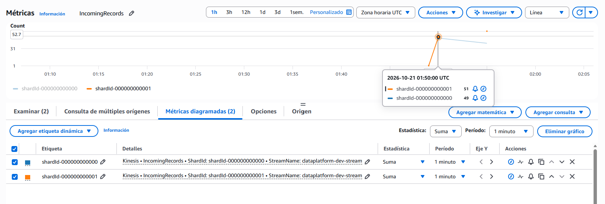

**Lectura de los resultados:**

- **Los dos shards reciben carga en todas las ejecuciones (49/51 y 40/60) y no hubo registros rechazados.** No hay hot shard: con una clave constante, los 100 registros habrían caído en un único shard.
- **La proporción varía entre ejecuciones porque el producer elige usuarios al azar en cada corrida.** Con 100 registros y 50 usuarios la muestra es chica. El reparto por hash tiende a 50/50 a medida que crecen el volumen y la cantidad de claves distintas.
- **El balance depende de cómo se reparte el tráfico entre claves, no solo de cuántas claves hay.** Si pocos usuarios concentraran la mayor parte de los eventos, su shard se cargaría más. Por eso el monitoreo incluye `IncomingRecords`/`IncomingBytes` por shard y la alarma de `WriteProvisionedThroughputExceeded`.

#### 3. Archivos entregados por Firehose en S3

Pasados ~60 s (intervalo de buffer):

```bash
aws s3 ls s3://dataplatform-dev-datalake-<ACCOUNT_ID>/raw/ingesta/ --recursive
```

```
2026-10-20 22:50:41       1791 raw/ingesta/year=2026/month=10/day=21/hour=01/dataplatform-dev-firehose-1-2026-10-21-01-49-40-3d57ebbb-1f50-4a54-9f6c-620f576ea3ac.gz
2026-10-20 22:51:20       1692 raw/ingesta/year=2026/month=10/day=21/hour=01/dataplatform-dev-firehose-1-2026-10-21-01-50-19-266d113e-d94b-45ab-828f-30b8feb69284.gz
2026-10-20 22:56:06       2045 raw/ingesta/year=2026/month=10/day=21/hour=01/dataplatform-dev-firehose-1-2026-10-21-01-55-00-7836d636-2b04-4c28-b6a9-c63751489fc5.gz
2026-10-20 22:56:26       1403 raw/ingesta/year=2026/month=10/day=21/hour=01/dataplatform-dev-firehose-1-2026-10-21-01-55-24-7f984928-5ca6-4d6a-b648-24fe92a69cb4.gz
```

- **Prefijo dinámico resuelto:** `!{timestamp:...}` se convirtió en `year=2026/month=10/day=21/hour=01/` (particionado estilo Hive, listo para Athena o Glue).
- **Buffer de 60 s en acción:** los archivos se generan aproximadamente un minuto después de cada envío. Ninguno llega a 5 MB, así que la entrega siempre la dispara el intervalo y no el tamaño.
- **Compresión:** los archivos son `.gz` porque Firehose comprime con GZIP antes de escribir.
- **Zona horaria:** la primera columna es la hora local (UTC-3) que muestra la CLI. El prefijo y el nombre del archivo usan UTC, por eso figuran 22:50 del día 20 y `day=21/hour=01` para el mismo instante.
- **Excepción de la bucket policy funcionando:** Firehose escribió en el bucket aunque el Data Lake solo acepta objetos que llegan por el VPC Endpoint. No aparecieron archivos en `raw/ingesta-errors/`.

#### 4. Alarmas

Las alarmas `dataplatform-dev-stream-write-throughput-exceeded` y `dataplatform-dev-stream-read-throughput-exceeded` quedaron en estado `OK` durante toda la prueba. Los volúmenes enviados están muy por debajo de la capacidad de 2 shards (2 MB/s o 2.000 registros/s de escritura).

### Costos y limpieza

En modo provisioned cada shard se cobra por hora aunque no reciba datos. La prueba se hizo y se destruyó en el mismo día:

```bash
cd infra/environments/dev
terraform destroy
```

La llave KMS queda programada para eliminarse a los 7 días (mínimo que exige AWS).

---


## Pre-entrega 4 — Procesamiento en tiempo real con Managed Service for Apache Flink

Se agrega la capa de **procesamiento stateful** sobre la ingesta de la pre-entrega 2. Una aplicación de **Amazon Managed Service for Apache Flink (MSF)** consume el mismo Kinesis Data Stream que Firehose y calcula, en tiempo real y por usuario, la actividad de cada minuto y el riesgo de **carrito abandonado**.

### Arquitectura

```
 producer.py (--interval: flujo continuo)
        │  PutRecord · PartitionKey = user_id
        ▼
 Kinesis Data Stream  dataplatform-dev-stream  (2 shards · KMS)          ← pre-entrega 2
        ├──► Firehose ──► S3 raw/ingesta/ (Bronze)                          ← pre-entrega 2
        │
        └──► Managed Service for Apache Flink  dataplatform-dev-clickstream-flink   ← pre-entrega 4
               runtime FLINK-1_19 · Parallelism 2 · ParallelismPerKPU 1 · 2 KPU (+1 orquestación)
               ┌────────────────────────────────────────────────────────────────────────┐
               │ ① kinesis-source         FlinkKinesisConsumer · 1 subtask por shard    │
               │                          polling 1 GetRecords/s (convive con Firehose) │
               │                          offsets por shard = Operator State           │
               │ ② parse-validate         JSON → ClickEvent (descarta inválidos)        │
               │ ③ event-time-watermarks  event_ts · 10 s de tolerancia · idleness 1 min │
               │ ④ keyBy(user_id) → Tumbling 1 min (Event Time) · allowedLateness 30 s   │
               │      AggregateFunction: contadores del minuto                         │
               │      ProcessWindowFunction: Keyed State entre ventanas (TTL 30 min)    │
               │ ⑤ sinks → CloudWatch Logs: USER_ACTIVITY · CART_ABANDONMENT_ALERT       │
               │      Side Output (muy tardíos) → LATE_EVENT                           │
               └────────────────────────────────────────────────────────────────────────┘
               Checkpoints cada 60 s (RocksDB) y snapshots → S3 administrado por MSF
        ▲
        └── código: s3://dataplatform-dev-flink-artifacts-<account>/flink/clickstream-processor/…jar
```

### Lógica de negocio

**Pregunta que responde:** ¿qué hace cada usuario minuto a minuto, y quién está acumulando productos en el carrito sin comprar?

| Paso | Qué hace | Por qué |
|---|---|---|
| **Event Time** | Usa `event_ts`, el momento en que el producer generó el evento | Determinista: el lag de Kinesis o un reproceso no cambian en qué minuto cae cada evento |
| **Watermark** | `forBoundedOutOfOrderness(10 s)` + `withIdleness(1 min)` | 10 s cubren red móvil, reintentos y la mezcla de 2 shards. Idleness evita que un shard sin tráfico congele las ventanas |
| **Ventana** | `TumblingEventTimeWindows` de 1 minuto por `user_id` | Cuenta `page_view`, `click`, `add_to_cart` y `checkout` de cada usuario en cada minuto |
| **Agregación incremental** | `AggregateFunction` (`EventCounts`) | Flink guarda solo 5 contadores por usuario y ventana, no todos los eventos |
| **Keyed State** | `pending-cart-items` en `context.globalState()` (por usuario, **entre ventanas**) | `add_to_cart` suma y `checkout` lo resetea a 0. Al llegar a 3 productos pendientes, se emite **una** alerta `CART_ABANDONMENT_ALERT` (cuando el usuario cruza el umbral) |
| **TTL del estado** | 30 minutos sin actividad | Un usuario inactivo libera su estado: el estado no crece indefinidamente |
| **Tardíos** | `allowedLateness(30 s)` + `sideOutputLateData` | Un tardío moderado re-emite la ventana corregida. Uno muy tardío va a `LATE_EVENT`: no se pierde en silencio |
| **Idempotencia** | `context.windowState()` guarda cuántos `add_to_cart` de la ventana ya se aplicaron | Si la ventana se re-emite por un tardío, el carrito pendiente suma **solo la diferencia** y no cuenta dos veces |

Salida (una línea JSON por usuario y minuto, fácil de consultar en CloudWatch Logs Insights):

```json
USER_ACTIVITY {"user_id":"user-0007","window_start":"2026-11-04T14:05:00Z","window_end":"2026-11-04T14:06:00Z","total_events":4,"page_views":1,"clicks":0,"add_to_cart":3,"checkouts":0,"pending_cart_items":3,"abandonment_risk":true,"alert_triggered":true}
```

### Código de la aplicación (`app/`)

```
app/
├── pom.xml                                   # Flink 1.19.1 (provided) + conector Kinesis (compile) → uber-jar
└── src/main/java/com/dataplatform/flink/
    ├── ClickstreamProcessingJob.java          # main: source, watermarks, ventana, sinks
    ├── ClickEvent.java                        # evento de entrada (POJO) + parseo y validación
    ├── EventCounts.java                       # AggregateFunction: contadores incrementales por ventana
    ├── CartAbandonmentFunction.java           # ProcessWindowFunction con Keyed State + TTL
    ├── UserActivity.java                      # resultado por usuario y ventana
    └── LoggingSink.java                       # sink a los logs de la aplicación (CloudWatch)
app/local/docker-compose.yml             # clúster Flink 1.19 local para correr el mismo .jar contra Kinesis
```

**Empaquetado:** las librerías de Flink (`flink-streaming-java`, `flink-clients`) y el logging van como `provided`, porque las trae el runtime de MSF; incluirlas genera conflictos de classpath. Dentro del uber-jar (`maven-shade-plugin`) van solo el conector de Kinesis, `aws-kinesisanalytics-runtime` (para leer las propiedades definidas en Terraform) y Jackson.

**Configuración sin valores en el código:** el stream, la región y los parámetros de tiempo (ventana, tolerancia, idleness, allowed lateness) llegan como propiedades de la aplicación (`FlinkApplicationProperties`), definidas en Terraform.

### Infraestructura (`infra/modules/flink/`)

| Recurso | Configuración | Por qué |
|---|---|---|
| `aws_s3_bucket` (artefactos) | `dataplatform-dev-flink-artifacts-<account>`: versionado, SSE, sin acceso público, solo HTTPS | Separado del Data Lake: la política del Data Lake solo admite objetos vía VPC Endpoint y MSF descarga el código desde fuera de la VPC |
| `aws_s3_object` | El `.jar` con `source_hash` | Si cambia el código, cambia la versión del objeto y Terraform actualiza la aplicación |
| `aws_iam_role` + policy | Leer **solo** ese `.jar`, leer **solo** el stream, `kms:Decrypt` vía Kinesis, escribir **solo** en su log group y publicar métricas en `AWS/KinesisAnalytics` | Mínimo privilegio, igual que los roles de las pre-entregas anteriores |
| `aws_cloudwatch_log_group` | `/aws/kinesis-analytics/dataplatform-dev-clickstream-flink`, 7 días | Resultados, alertas y eventos tardíos |
| `aws_kinesisanalyticsv2_application` | Runtime `FLINK-1_19`, código en S3 (versión concreta), propiedades, checkpointing, monitoreo, paralelismo, snapshots y restauración | La aplicación completa definida como código |

**Checkpointing (`checkpoint_configuration`):**

- `checkpointing_enabled = true`, cada **60 s**, con 5 s de pausa mínima entre checkpoints.
- El estado vive en RocksDB, en cada KPU, y los checkpoints se guardan en el **S3 administrado por el servicio**. En MSF esa ruta no se configura: la gestiona AWS, que es lo que garantiza la recuperación automática.
- `snapshots_enabled = true`, `RESTORE_FROM_LATEST_SNAPSHOT` y `allow_non_restored_state = false`: un `terraform apply` que cambia el código o el paralelismo **conserva** las ventanas abiertas y los carritos pendientes. Si algún operador no puede recuperar su estado, la aplicación falla en lugar de descartarlo (todos los operadores tienen `uid` fijo).

**Monitoreo (`monitoring_configuration`):** logs en nivel `INFO`, que es donde salen `USER_ACTIVITY`, las alertas y los tardíos, y métricas a nivel `TASK`: `millisBehindLatest`, `backPressuredTimeMsPerSecond`, `lastCheckpointDuration`.

**Convivencia con Firehose (dos consumidores sobre el mismo stream):** Flink y Firehose leen el stream de forma independiente: cada uno lleva su propia posición por shard y ninguno "consume" los datos del otro. Lo que **sí** comparten en modo polling es el cupo de lectura de cada shard: **5 llamadas `GetRecords` por segundo y 2 MB/s**. Firehose hace 1 llamada por segundo por shard, pero el conector de Flink por defecto consulta cada 200 ms (5 por segundo). Juntos superarían el cupo y dispararían la alarma `ReadProvisionedThroughputExceeded` de la pre-entrega 2. Por eso el source se configura con **1 llamada por segundo** (`kinesis.getrecords.interval.ms = 1000`): en total 2 de 5 llamadas por shard, con margen. El costo es hasta ~1 s más de latencia de lectura, despreciable frente a ventanas de 1 minuto. En producción, con más consumidores o más volumen, se pasaría a **Enhanced Fan-Out**: cada consumidor tiene sus propios 2 MB/s por shard, a cambio de un costo por consumidor y por shard.

**Conectividad:** la aplicación **no** se despliega dentro de la VPC (`vpc_config = null`). Su fuente (Kinesis), su código (S3) y sus logs (CloudWatch) son servicios administrados a los que MSF accede por sus endpoints de AWS, cifrados con TLS y autorizados por el rol de ejecución. Meterla en las subredes privadas de la pre-entrega 1, que no tienen NAT, obligaría a crear VPC endpoints de interfaz para `kinesis-streams`, `logs` y `monitoring`. El módulo lo deja preparado con la variable `vpc_config` para cuando el job necesite llegar a recursos privados (por ejemplo, una base de datos en la VPC).

### Paralelismo y KPUs

```
Shards del stream                      2
Parallelism                            2   = module.kinesis.shard_count (1 subtask de source por shard)
ParallelismPerKPU                      1   cada subtask tiene su KPU completa para el estado RocksDB
KPUs de procesamiento = 2 / 1 =        2   (1 KPU = 1 vCPU + 4 GB RAM + 50 GB de almacenamiento)
KPU de orquestación                   +1   la agrega MSF por aplicación
Total facturado                        3 KPU
Auto scaling                           desactivado: escalado manual y predecible, siempre desde snapshot
```

El paralelismo se toma del output `shard_count` del módulo `kinesis`: si el stream crece (por ejemplo, de 2 a 4 shards), el job acompaña en el próximo `terraform apply`, y lo hace restaurando el estado desde el último snapshot.

### Despliegue

**1. Compilar la aplicación** (no requiere Java ni Maven instalados: usa Docker):

```powershell
docker run --rm -v "${PWD}/app:/app" -w /app maven:3.9-eclipse-temurin-11 mvn -B -q package
# genera app/target/clickstream-processor-1.0.jar
```

**2. Subir el código y desplegar (la aplicación queda creada pero detenida):**

```bash
cd infra/environments/dev
terraform init -backend-config="backend.hcl"
terraform validate
terraform plan
terraform apply        # sube el .jar a S3 y crea rol, logs y la aplicación (start_application = false)
terraform output flink_application_name
```

**3. Arrancar el job** (recién acá empieza a facturar KPUs):

```bash
aws kinesisanalyticsv2 start-application --application-name dataplatform-dev-clickstream-flink \
  --run-configuration '{"ApplicationRestoreConfiguration":{"ApplicationRestoreType":"SKIP_RESTORE_FROM_SNAPSHOT"}}'
aws kinesisanalyticsv2 describe-application --application-name dataplatform-dev-clickstream-flink \
  --query 'ApplicationDetail.ApplicationStatus'      # STARTING → RUNNING (2-3 minutos)
```

**4. Generar tráfico continuo** (con algunos eventos atrasados para ejercitar watermarks y tardíos):

```bash
python scripts/producer.py --stream-name dataplatform-dev-stream --count 600 --users 20 --interval 0.5 --late-rate 0.05
```

### Evidencia de ejecución

#### Estado del despliegue en AWS

`terraform apply` creó toda la infraestructura del checkpoint: el bucket de artefactos con el `.jar` subido, el rol de ejecución con su política, el log group, y la infraestructura de las pre-entregas 1 y 2. La creación del recurso `aws_kinesisanalyticsv2_application` fue rechazada por AWS **a nivel de cuenta**, no por la configuración:

```
Error: creating Kinesis Analytics v2 Application (dataplatform-dev-clickstream-flink):
UnsupportedOperationException: Your account <ACCOUNT_ID> needs additional verification for
creating or updating applications. Create a support case with the AWS Account Verification team
for further assistance.
```

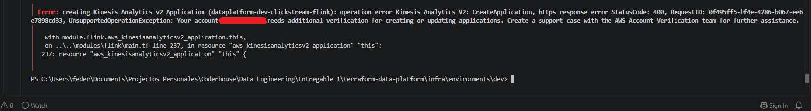

Es una restricción que AWS aplica a cuentas nuevas para Managed Service for Apache Flink. Se abrió un caso de soporte para habilitar el servicio. Una vez habilitado, alcanza con repetir `terraform apply`: el resto de la infraestructura ya existe y Terraform solo crea la aplicación.

#### Ejecución del mismo job en un clúster Flink 1.19 contra el Kinesis real

Mientras tanto, para validar el procesamiento de punta a punta, el **mismo `.jar`** se ejecutó en un clúster Flink **1.19.1** (la versión del runtime `FLINK-1_19` de MSF) levantado con Docker (`app/local/docker-compose.yml`: JobManager y TaskManager con 2 slots, RocksDB y checkpoints cada 60 s). El job consumió el **Kinesis Data Stream real** de AWS (`dataplatform-dev-stream`, 2 shards, cifrado con KMS) con las credenciales del usuario IAM. Sin propiedades de MSF, el job usa sus valores por defecto: el mismo stream, región, ventana de 1 minuto, 10 s de tolerancia, 1 min de idleness y 30 s de *allowed lateness*.

```powershell
docker compose -f app/local/docker-compose.yml up -d
docker compose -f app/local/docker-compose.yml exec jobmanager flink run -d -p 2 /job/clickstream-processor-1.0.jar
python scripts/producer.py --stream-name dataplatform-dev-stream --count 600 --users 20 --interval 0.5 --late-rate 0.05
```

**1. Grafo del job en el Flink Dashboard** (`http://localhost:8081` → *Running Jobs* → `clickstream-user-activity`):

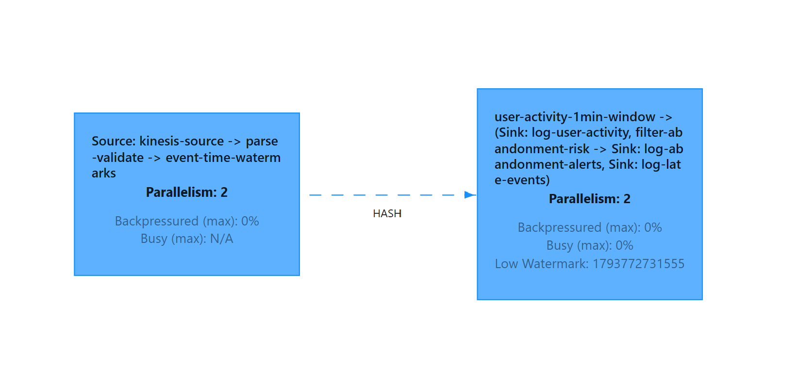

**2. Resultados del procesamiento** (logs del TaskManager, donde escribe `LoggingSink`):

```powershell
docker compose -f app/local/docker-compose.yml logs taskmanager | Select-String "USER_ACTIVITY|CART_ABANDONMENT_ALERT|LATE_EVENT"
```

```
06:07:21 WARN  LATE_EVENT ClickEvent{user-0010, checkout, 2026-11-04T06:05:52.957445+00:00}
06:07:24 INFO  USER_ACTIVITY {"user_id":"user-0001","window_start":"2026-11-04T06:06:00Z","window_end":"2026-11-04T06:07:00Z","total_events":1,"page_views":0,"clicks":0,"add_to_cart":1,"checkouts":0,"pending_cart_items":1,"abandonment_risk":false,"alert_triggered":false}
06:07:29 WARN  LATE_EVENT ClickEvent{user-0008, add_to_cart, 2026-11-04T06:05:58.036889+00:00}
06:08:12 INFO  USER_ACTIVITY {"user_id":"user-0001","window_start":"2026-11-04T06:07:00Z","window_end":"2026-11-04T06:08:00Z","total_events":7,"page_views":0,"clicks":2,"add_to_cart":5,"checkouts":0,"pending_cart_items":6,"abandonment_risk":true,"alert_triggered":true}
06:08:12 WARN  CART_ABANDONMENT_ALERT {"user_id":"user-0001","window_start":"2026-11-04T06:07:00Z","window_end":"2026-11-04T06:08:00Z","total_events":7,"page_views":0,"clicks":2,"add_to_cart":5,"checkouts":0,"pending_cart_items":6,"abandonment_risk":true,"alert_triggered":true}
06:08:12 INFO  USER_ACTIVITY {"user_id":"user-0003","window_start":"2026-11-04T06:07:00Z","window_end":"2026-11-04T06:08:00Z","total_events":6,"page_views":3,"clicks":2,"add_to_cart":0,"checkouts":1,"pending_cart_items":0,"abandonment_risk":false,"alert_triggered":false}
06:08:12 INFO  USER_ACTIVITY {"user_id":"user-0006","window_start":"2026-11-04T06:07:00Z","window_end":"2026-11-04T06:08:00Z","total_events":8,"page_views":2,"clicks":2,"add_to_cart":4,"checkouts":0,"pending_cart_items":4,"abandonment_risk":true,"alert_triggered":true}
06:08:12 WARN  CART_ABANDONMENT_ALERT {"user_id":"user-0006","window_start":"2026-11-04T06:07:00Z","window_end":"2026-11-04T06:08:00Z","total_events":8,"page_views":2,"clicks":2,"add_to_cart":4,"checkouts":0,"pending_cart_items":4,"abandonment_risk":true,"alert_triggered":true}
06:08:12 INFO  USER_ACTIVITY {"user_id":"user-0009","window_start":"2026-11-04T06:07:00Z","window_end":"2026-11-04T06:08:00Z","total_events":6,"page_views":1,"clicks":3,"add_to_cart":0,"checkouts":1,"pending_cart_items":0,"abandonment_risk":false,"alert_triggered":false}
06:08:31 INFO  USER_ACTIVITY {"user_id":"user-0009","window_start":"2026-11-04T06:07:00Z","window_end":"2026-11-04T06:08:00Z","total_events":7,"page_views":1,"clicks":4,"add_to_cart":0,"checkouts":1,"pending_cart_items":0,"abandonment_risk":false,"alert_triggered":false}
```

*(extracto; hora del TaskManager en UTC)*

**Lectura de la salida:**

- **Ventanas de 1 minuto por usuario:** a las 06:08:12, apenas el watermark pasó las 06:08:00 (fin de ventana + 10 s de tolerancia), se emitió un `USER_ACTIVITY` por cada usuario activo en la ventana `06:07–06:08`.
- **Keyed State entre ventanas:** `user-0001` venía con 1 producto pendiente de la ventana anterior y sumó 5 sin checkout: `pending_cart_items = 6`, y se emitió **una** `CART_ABANDONMENT_ALERT`. `user-0003` hizo checkout y su carrito quedó en 0.
- **Allowed lateness:** a las 06:08:31 la ventana `06:07–06:08` de `user-0009` se **re-emitió corregida** (de 6 a 7 eventos, de 3 a 4 clicks) porque llegó un evento tardío dentro de los 30 s permitidos.
- **Side Output:** los eventos que el producer generó con event time atrasado (`--late-rate`), por ejemplo un `checkout` de las 06:05:52 que llegó a las 06:07:21, ya no tenían ventana abierta y salieron como `LATE_EVENT`, en lugar de perderse en silencio.

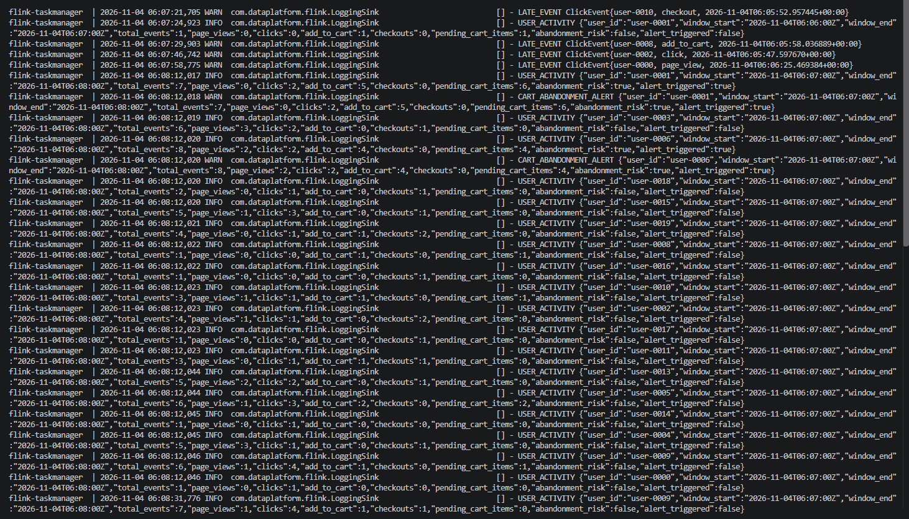

En MSF, esas mismas líneas van a CloudWatch Logs (log group `/aws/kinesis-analytics/dataplatform-dev-clickstream-flink`) y se consultan con Logs Insights:

```
fields @timestamp, message
| filter message like /USER_ACTIVITY|CART_ABANDONMENT_ALERT|LATE_EVENT/
| sort @timestamp desc
| limit 50
```

### Validación local de la lógica

Antes del despliegue, las clases del pipeline (`EventCounts`, `CartAbandonmentFunction`, `LoggingSink`) se ejecutaron en un mini-clúster local de Flink 1.19.1 con una secuencia controlada de eventos: desordenados, tardíos y muy tardíos. Con ventanas de 1 minuto, 10 s de tolerancia y 30 s de *allowed lateness*, la salida fue:

```
llega user-a add_to_cart 10:00:05 · user-a add_to_cart 10:00:20 · user-b page_view 10:00:30
llega user-a page_view 10:00:50 · user-b click 10:00:45 (desordenado) · user-a add_to_cart 10:01:05
llega user-b page_view 10:01:12   → watermark 10:01:02 ≥ fin de ventana: dispara [10:00, 10:01)
USER_ACTIVITY {"user_id":"user-a",...,"add_to_cart":2,"pending_cart_items":2,"abandonment_risk":false}
USER_ACTIVITY {"user_id":"user-b",...,"page_views":1,"clicks":1,...}
llega user-a add_to_cart 10:00:55 (tardío, dentro de allowedLateness) → la ventana se re-emite corregida
USER_ACTIVITY {"user_id":"user-a",...,"add_to_cart":3,"pending_cart_items":3,"abandonment_risk":true}
CART_ABANDONMENT_ALERT {"user_id":"user-a",...,"pending_cart_items":3,"alert_triggered":true}
llega user-b checkout 10:01:40 · user-a click 10:00:10 (muy tardío: la ventana ya expiró)
LATE_EVENT ClickEvent{user-a, click, 2026-11-04T10:00:10Z}
llega user-a page_view 10:02:20   → dispara [10:01, 10:02)
USER_ACTIVITY {"user_id":"user-a",...,"add_to_cart":1,"pending_cart_items":4,"abandonment_risk":true}
USER_ACTIVITY {"user_id":"user-b",...,"checkouts":1,"pending_cart_items":0,...}
```

- **Desorden:** `user-b click 10:00:45` llegó después de `10:00:50` y entró igual en su ventana.
- **Corrección por tardío:** el `add_to_cart 10:00:55` re-emitió la ventana. El carrito pendiente pasó de 2 a **3**, no a 5: la idempotencia evitó contar dos veces los dos productos anteriores.
- **Alerta única:** se emitió al cruzar el umbral (3) y no se repitió en la ventana siguiente, aunque el riesgo siguiera activo.
- **Side Output:** el `click 10:00:10` llegó cuando la ventana ya había expirado y salió por `LATE_EVENT`.
- **Checkout:** el de `user-b` dejó su carrito pendiente en 0.

### Costos y limpieza

MSF se factura por KPU-hora mientras la aplicación corre: 3 KPU en este diseño. Para pruebas:

```bash
# Detener la aplicación sin destruir nada (toma un snapshot del estado)
aws kinesisanalyticsv2 stop-application --application-name dataplatform-dev-clickstream-flink

# Eliminar todo el entorno
cd infra/environments/dev
terraform destroy
```

## Pre-entrega 5 — Pipeline Lakehouse con Apache Iceberg y AWS Glue Data Catalog

La salida del job de Flink deja de ser solo un log y pasa a ser una **tabla Apache Iceberg** (`lakehouse_db.user_activity`), registrada y gobernada en el **AWS Glue Data Catalog** y consultable con **Athena**. Así el resultado del streaming tiene transacciones ACID, *time travel* y evolución de esquema sobre S3.

### Arquitectura

```
 Kinesis (dataplatform-dev-stream) ──► Flink: ventana 1 min por user_id + Keyed State      (pre-entrega 4)
                                           │
                                           ├─► CloudWatch / logs: USER_ACTIVITY, alertas, tardíos
                                           │
                                           └─► IcebergSink  (upsert por user_id + window_start)
                                                 │  escribe Parquet continuamente
                                                 │  commitea en cada checkpoint (60 s)
                                                 ▼
 ┌──────────────── Capa de catálogo ────────────────┐
 │ AWS Glue Data Catalog · base lakehouse_db         │  puntero atómico al metadata.json vigente
 │   tabla user_activity (table_type = ICEBERG)      │  (commit = UpdateTable condicionado al VersionId)
 └───────────────────────┬───────────────────────────┘
                         ▼
 ┌──────────────── Capa de almacenamiento: s3://dataplatform-dev-lakehouse-<account>/warehouse/ ────────────────┐
 │ lakehouse_db.db/user_activity/                                                                               │
 │   metadata/00012-….metadata.json   esquema, partition spec, lista de snapshots                              │
 │   metadata/snap-….avro             manifest list del snapshot (estadísticas por manifest)                    │
 │   metadata/….-m0.avro              manifests: archivos de datos + min/max por columna                        │
 │   data/window_start_day=2026-11-04/….parquet   archivos de datos (Parquet + zstd)                          │
 └──────────────────────────────────────────────────────────────────────────────────────────────────────────────┘
                         ▲
 Athena (workgroup dataplatform-dev-lakehouse, engine v3): lee el snapshot vigente, nunca escrituras a medias
```

### Infraestructura (`infra/modules/lakehouse/`)

| Recurso | Configuración | Por qué |
|---|---|---|
| `aws_glue_catalog_database` **`lakehouse_db`** | `location_uri = s3://…-lakehouse-…/warehouse/lakehouse_db.db` | Metastore central del Lakehouse: contiene el puntero a la metadata vigente de cada tabla Iceberg |
| `aws_s3_bucket` (Lakehouse) | **Versionado**, SSE, sin acceso público, solo HTTPS, lifecycle (versiones viejas a 7 días y resultados de Athena a 7 días) | Separado del Data Lake de la pre-entrega 1: aquel solo admite objetos vía VPC Endpoint, y los actores del Lakehouse (Flink en MSF, Glue, Athena) son servicios administrados que acceden desde fuera de la VPC |
| `aws_athena_workgroup` | Engine v3 (requerido para Iceberg), resultados en `athena-results/` | Consumo SQL de las tablas |
| `aws_iam_policy` **`lakehouse-writer`** | `glue:GetDatabase/GetTable/GetTables/CreateTable/UpdateTable` **solo** sobre `lakehouse_db` y sus tablas; `s3:Get/Put/DeleteObject` **solo** sobre `warehouse/*` | Se adjunta al rol de ejecución de Flink desde `environments/dev` (`additional_policy_arns`), sin acoplar los módulos |

Integración con lo anterior (`infra/environments/dev/main.tf`): el módulo `flink` recibe del módulo `lakehouse` el warehouse, la base, la tabla y la política del escritor. Los valores llegan a la app como propiedades de MSF (`iceberg.warehouse`, `iceberg.database`, `iceberg.table`), sin nada escrito en el código.

### Implementación en Flink (`app/`)

**Dependencias** (`app/pom.xml`, versiones alineadas para evitar el *mismatch* de versiones):

| Dependencia | Scope | Rol |
|---|---|---|
| `iceberg-flink-runtime-1.19` 1.7.1 | compile | `IcebergSink`, `CatalogLoader`, `TableLoader`, para el mismo Flink 1.19 del runtime de MSF |
| `iceberg-aws-bundle` 1.7.1 | compile | `GlueCatalog` y `S3FileIO` (AWS SDK v2) |
| `hadoop-client-api` / `hadoop-client-runtime` 3.3.6 | compile | Iceberg-Flink requiere `org.apache.hadoop.conf.Configuration`. Se usan las variantes *shaded*: no se usa HDFS y no contaminan el classpath |
| `flink-table-common` / `flink-table-runtime` | provided | Tipos `RowData` que consume el sink; los trae el runtime |

**Catálogo** (`IcebergLakehouse.catalogLoader`): `CatalogLoader.custom(..., "org.apache.iceberg.aws.glue.GlueCatalog")` con `warehouse`, `io-impl = S3FileIO` y la región.

**Tabla** (`IcebergLakehouse.ensureTable`): la base la crea Terraform; la tabla la crea la app **si no existe**, con un esquema de **IDs de columna explícitos** (la base de la evolución segura de esquemas), formato v2 y su partition spec. Es idempotente: en cada arranque reutiliza la tabla existente.

**Esquema de `user_activity`:**

| Columna | Tipo | |
|---|---|---|
| `user_id` | string (required) | identifier field |
| `window_start` | timestamp (required) | identifier field · **fuente de la partición** |
| `window_end` | timestamp | |
| `total_events`, `page_views`, `clicks`, `add_to_cart`, `checkouts` | long | contadores de la ventana |
| `pending_cart_items` | long | Keyed State entre ventanas |
| `abandonment_risk`, `alert_triggered` | boolean | |
| `processed_at` | timestamp | momento de escritura (auditoría) |

**Sink** (`ClickstreamProcessingJob`):

```java
IcebergSink.forRowData(rows)
        .tableLoader(TableLoader.fromCatalog(catalogLoader, tableId))
        .equalityFieldColumns(List.of("user_id", "window_start"))
        .upsert(true)
        .append();
```

- **Commits atados al checkpoint:** el sink escribe Parquet continuamente, pero **commitea** (nuevo snapshot y actualización atómica del puntero en Glue) solo cuando Flink completa un checkpoint, cada 60 s (`checkpoint_configuration` en Terraform). Sin checkpointing habría archivos en S3 y la tabla en el catálogo seguiría vacía.
- **Upsert:** `allowedLateness` puede re-emitir una ventana corregida. Con upsert por `(user_id, window_start)`, la fila corregida **reemplaza** a la anterior (equality delete de Iceberg v2) en lugar de duplicarla. Es la misma idempotencia que ya tenía el estado del carrito, ahora también en la tabla.
- **Exactly-once de punta a punta:** offsets de Kinesis y archivos pendientes viajan en el mismo checkpoint. Ante un fallo, Flink retoma desde el último checkpoint y los archivos no commiteados nunca se vuelven visibles.

### Estrategia de particionado: `day(window_start)`

```java
PartitionSpec.builderFor(SCHEMA).day("window_start").build();
```

- **Partition pruning:** las consultas del negocio filtran por tiempo ("actividad de hoy", "últimas 2 horas"). Con `day(window_start)`, Athena descarta los días que no corresponden **antes** de abrir un solo archivo.
- **Hidden partitioning:** la columna de partición es derivada. El analista filtra por `window_start` como en cualquier tabla y Iceberg aplica el pruning solo, sin columnas `year/month/day` artificiales como en Hive.
- **Cardinalidad razonable:** una partición por día, unas 365 al año. No se particiona por `user_id`: con alta cardinalidad generaría miles de particiones con archivos minúsculos, *metadata overhead* en Glue y en los manifests, y una planificación de consultas más lenta que la ejecución. Si en el futuro hiciera falta acelerar los filtros por usuario, se agregaría `bucket(16, user_id)` (cardinalidad acotada) o un *sort order* por `user_id` en la compactación, sin reescribir la tabla gracias a la evolución de partición de Iceberg.
- **Eventos tardíos:** la partición sale del **event time** de la ventana, no de la hora de escritura. Una ventana de las 23:59 corregida a las 00:00:20 sigue cayendo en su día.

### Concurrencia de commits en Glue

El `GlueCatalog` commitea con **control de concurrencia optimista**: `UpdateTable` condicionado al `VersionId` que la tabla tenía al empezar el commit. Glue rechaza el cambio si otro escritor commiteó en el medio. El *lock* lo provee el propio Glue, sin necesidad de una tabla DynamoDB de locks.

- **Un único committer:** el `IcebergSink` hace el commit desde un solo operador (paralelismo 1 del committer), aunque escriban 2 subtasks. No hay commits concurrentes del mismo job, y por lo tanto no aparece `ConcurrentModificationException`.
- **Reintentos:** si en el futuro otro proceso escribe la misma tabla (por ejemplo, la compactación), `commit.retry.num-retries = 10` reintenta sobre la metadata nueva en lugar de fallar.
- `glue.skip-archive = true`: Glue no guarda una versión de la tabla por cada commit (con commits cada minuto, serían miles). El historial queda en los snapshots de Iceberg.

### Propiedades de la tabla y mantenimiento

| Propiedad | Valor | Para qué |
|---|---|---|
| `format-version` | 2 | Upserts con equality deletes |
| `write.format.default` / `compression-codec` | parquet / zstd | Columnar y comprimido |
| `write.target-file-size-bytes` | 128 MB | Tamaño objetivo de archivo (lo alcanza la compactación) |
| `write.distribution-mode` | hash | Agrupa por partición antes de escribir: menos archivos por commit |
| `write.metadata.delete-after-commit.enabled` / `previous-versions-max` | true / 50 | Acota los `metadata.json` viejos |
| `history.expire.max-snapshot-age-ms` | 7 días | Ventana de *time travel* |
| `commit.retry.num-retries` | 10 | Reintentos ante conflictos de commit |

**Small files:** con un commit por minuto, la tabla genera ~2 archivos por minuto, unos 2.880 por día (los de datos y los de deletes de los upserts). Es el costo de la frescura. Se corrige con mantenimiento periódico, por ejemplo diario, desde Athena o un job de Glue programado:

```sql
-- Compactación bin-pack: combina archivos chicos en archivos de ~128 MB
OPTIMIZE lakehouse_db.user_activity REWRITE DATA USING BIN_PACK
  WHERE window_start >= CAST(current_timestamp AS timestamp) - interval '1' day;

-- Expira snapshots fuera de la retención (7 días) y borra los archivos huérfanos
VACUUM lakehouse_db.user_activity;
```

La compactación tiene costo (*write amplification*: reescribe datos que ya estaban en S3), por eso se hace diaria y sobre la partición reciente, no en cada commit. Alternativa administrada: la *auto-compaction* del Glue Data Catalog para tablas Iceberg.

### Despliegue y prueba

```powershell
# 1. Compilar (incluye Iceberg; el .jar pesa más que en la pre-entrega 4)
docker run --rm -v "${PWD}/app:/app" -w /app maven:3.9-eclipse-temurin-11 mvn -B -q package

# 2. Infraestructura: lakehouse_db, bucket, Athena, IAM (+ lo de las pre-entregas anteriores)
cd infra/environments/dev
terraform init -backend-config="backend.hcl"
terraform apply
$env:ICEBERG_WAREHOUSE = terraform output -raw lakehouse_warehouse
cd ../../..

# 3. Ejecutar el job. En MSF: aws kinesisanalyticsv2 start-application ...
#    Mientras la cuenta no tenga MSF habilitado: el mismo .jar en el clúster Flink 1.19 local
docker compose -f app/local/docker-compose.yml up -d
docker compose -f app/local/docker-compose.yml exec jobmanager flink run -d -p 2 /job/clickstream-processor-1.0.jar

# 4. Tráfico
python scripts/producer.py --stream-name dataplatform-dev-stream --count 600 --users 20 --interval 0.5 --late-rate 0.05
```

Esperar al menos 2 checkpoints (2 minutos) y verificar en Glue, S3 y Athena.

> **Nota sobre MSF:** la cuenta sigue con la restricción de verificación descripta en la pre-entrega 4 (`UnsupportedOperationException … needs additional verification`, ver [captura](docs/flink-conflict-creation.png)). Por eso la evidencia de abajo se generó con el mismo `.jar` corriendo en el clúster Flink 1.19.1 local, contra el Kinesis, el Glue Data Catalog, el S3 y el Athena **reales** de AWS. El código y la infraestructura son los mismos: cuando AWS habilite el servicio, `terraform apply` crea la aplicación con las propiedades `iceberg.*` y la política `lakehouse-writer` ya adjunta.

### Evidencia

#### 1. Tabla Iceberg registrada en el Glue Data Catalog

Consola de AWS Glue → Data Catalog → Databases → `lakehouse_db` → Tables → `user_activity` (tipo de tabla **Iceberg**, esquema y ubicación en S3):

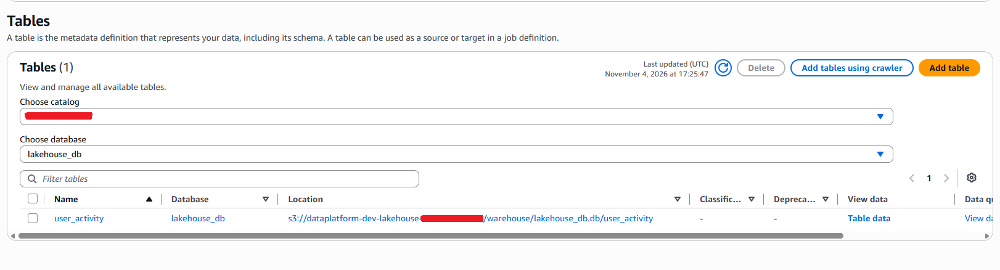

#### 2. Formato Iceberg en S3: carpeta `metadata/`

```powershell
aws s3 ls "$env:ICEBERG_WAREHOUSE/lakehouse_db.db/user_activity/metadata/"
```

```
2026-11-04 14:22:01    2681 00000-96d2ddb0-c561-4079-9108-5898a5feb5e2.metadata.json
2026-11-04 14:23:50    4341 00001-05821f1f-2653-4738-9fa8-8a1ad667a738.metadata.json
2026-11-04 14:24:50    5946 00002-c8afa934-2367-49ac-a9b3-8731013d0269.metadata.json
2026-11-04 14:25:49    7470 00003-2d7d11ea-4980-45e6-b8c0-99b68358f9c9.metadata.json
2026-11-04 14:26:49    8994 00004-f089b39b-5f83-41a1-b1d2-285c2ccf50af.metadata.json
2026-11-04 14:27:49   10600 00005-ab3bf576-b19e-482f-aa5a-bfa1c4920562.metadata.json
2026-11-04 14:28:49   12208 00006-307a0758-2c5e-4655-9e5a-742c023e0255.metadata.json
2026-11-04 14:28:48    7808 5da6c0f1-a8d5-42a5-a632-a14541a878ad-m0.avro
2026-11-04 14:28:48    7741 5da6c0f1-a8d5-42a5-a632-a14541a878ad-m1.avro
...
2026-11-04 14:23:50    4509 snap-1730212703600013605-1-cdf8f97c-5f79-43a5-afa0-dafd8bdbbe6a.avro
2026-11-04 14:24:49    4592 snap-8446357772246081948-1-69f8ebb8-4a08-4819-bbe2-6f5bf2fb8334.avro
2026-11-04 14:25:48    4647 snap-7734524313382199758-1-5fe2fe71-02a1-466d-b6e3-c70154f9b752.avro
2026-11-04 14:26:49    4702 snap-6531474432029485937-1-61d21eef-8153-41a5-a129-f5f2862a871d.avro
2026-11-04 14:27:49    4763 snap-8855986889323893130-1-ddf66a93-d229-4c28-ac98-31a0c53b5011.avro
2026-11-04 14:28:49    4822 snap-9008163909663980986-1-5da6c0f1-a8d5-42a5-a632-a14541a878ad.avro
```

*(hora local UTC-3; extracto)*

**Lectura:**

- **`00000-….metadata.json`:** la creación de la tabla (esquema, partition spec y propiedades, sin snapshots) que hizo `ensureTable` al arrancar el job.
- **`00001` a `00006`:** un `metadata.json` nuevo **cada ~60 segundos**, es decir, un commit por cada checkpoint de Flink. Cada uno referencia todos los snapshots anteriores, por eso crece (de 4 KB a 12 KB).
- **`snap-….avro` (manifest lists):** uno por snapshot, con el mismo timestamp que su `metadata.json`.
- **`…-m0.avro` y `…-m1.avro` (manifests):** dos por commit, que listan los archivos que agrega cada snapshot. Con upsert (Iceberg v2), un commit registra los archivos de datos y los *delete files* que reemplazan las versiones anteriores de las ventanas re-emitidas por `allowedLateness`.
- La jerarquía completa del formato Iceberg (catálogo → metadata JSON → manifest list → manifests → Parquet) queda verificada en S3, y en Glue la tabla apunta a la ubicación `warehouse/lakehouse_db.db/user_activity`.

#### 3. Consulta en Athena: los datos reflejan las transformaciones de Flink

Athena → workgroup `dataplatform-dev-lakehouse` → base `lakehouse_db`:

```sql
SELECT user_id, window_start, window_end, total_events, add_to_cart, checkouts,
       pending_cart_items, abandonment_risk, alert_triggered
FROM lakehouse_db.user_activity
WHERE window_start >= TIMESTAMP '2026-11-04 00:00:00'   -- partition pruning por day(window_start)
ORDER BY window_start DESC, pending_cart_items DESC
LIMIT 20;
```

```
user_id    window_start             window_end               total_events add_to_cart checkouts pending_cart_items abandonment_risk alert_triggered
user-0001  2026-11-04 17:27:00.000  2026-11-04 17:28:00.000  7            3           0         3                  true             true
user-0011  2026-11-04 17:27:00.000  2026-11-04 17:28:00.000  2            0           0         2                  false            false
user-0003  2026-11-04 17:27:00.000  2026-11-04 17:28:00.000  1            1           0         2                  false            false
user-0007  2026-11-04 17:27:00.000  2026-11-04 17:28:00.000  5            1           0         1                  false            false
user-0000  2026-11-04 17:27:00.000  2026-11-04 17:28:00.000  5            3           1         0                  false            false
user-0019  2026-11-04 17:27:00.000  2026-11-04 17:28:00.000  5            3           1         0                  false            false
user-0015  2026-11-04 17:27:00.000  2026-11-04 17:28:00.000  6            2           2         0                  false            false
user-0005  2026-11-04 17:27:00.000  2026-11-04 17:28:00.000  4            0           1         0                  false            false
user-0002  2026-11-04 17:27:00.000  2026-11-04 17:28:00.000  4            0           1         0                  false            false
user-0018  2026-11-04 17:27:00.000  2026-11-04 17:28:00.000  6            2           3         0                  false            false
user-0012  2026-11-04 17:27:00.000  2026-11-04 17:28:00.000  2            0           0         0                  false            false
user-0017  2026-11-04 17:27:00.000  2026-11-04 17:28:00.000  2            0           2         0                  false            false
user-0008  2026-11-04 17:27:00.000  2026-11-04 17:28:00.000  5            0           2         0                  false            false
user-0010  2026-11-04 17:27:00.000  2026-11-04 17:28:00.000  1            0           0         0                  false            false
user-0009  2026-11-04 17:27:00.000  2026-11-04 17:28:00.000  3            1           1         0                  false            false
user-0006  2026-11-04 17:27:00.000  2026-11-04 17:28:00.000  8            1           2         0                  false            false
user-0016  2026-11-04 17:27:00.000  2026-11-04 17:28:00.000  3            2           1         0                  false            false
user-0004  2026-11-04 17:27:00.000  2026-11-04 17:28:00.000  7            2           1         0                  false            false
user-0014  2026-11-04 17:27:00.000  2026-11-04 17:28:00.000  7            1           1         0                  false            false
user-0013  2026-11-04 17:27:00.000  2026-11-04 17:28:00.000  6            1           3         0                  false            false
```

**Lectura:**

- Cada fila es el resultado de una **ventana tumbling de 1 minuto por usuario** calculada por Flink (`window_start`/`window_end` alineados al minuto, en UTC).
- `pending_cart_items` sale del **Keyed State** del `CartAbandonmentFunction`: es acumulado entre ventanas, por eso puede ser mayor que `add_to_cart` de la ventana (ej. `user-0011`: 0 agregados en este minuto, 2 pendientes de minutos anteriores) o quedar en 0 cuando hubo checkouts (`user-0000`, `user-0015`, `user-0018`).
- `user-0001` llegó a 3 ítems pendientes sin checkout: Flink marcó `abandonment_risk = true` y disparó la alerta (`alert_triggered = true`). La regla de negocio del job queda visible directamente en SQL sobre el Lakehouse.
- Gracias al upsert por `(user_id, window_start)`, las ventanas re-emitidas por `allowedLateness` no se duplican: hay **una sola fila por usuario y ventana**.

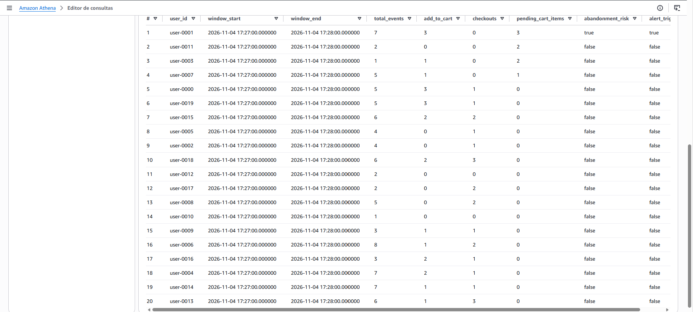

#### 4. Snapshots (un commit por checkpoint) y time travel

```sql
SELECT committed_at, snapshot_id, operation, summary['added-records'] AS added_records
FROM "lakehouse_db"."user_activity$snapshots"
ORDER BY committed_at DESC
LIMIT 10;

-- Time travel: la tabla tal como estaba hace 5 minutos
SELECT count(*) FROM lakehouse_db.user_activity
FOR TIMESTAMP AS OF (current_timestamp - interval '5' minute);
```

```
committed_at                 snapshot_id          operation  added_records
2026-11-04 17:28:47.935 UTC  9008163909663980986  overwrite  22
2026-11-04 17:27:47.948 UTC  8855986889323893130  overwrite  21
2026-11-04 17:26:48.039 UTC  6531474432029485937  overwrite  20
2026-11-04 17:25:47.900 UTC  7734524313382199758  overwrite  19
2026-11-04 17:24:48.717 UTC  8446357772246081948  overwrite  21
2026-11-04 17:23:48.961 UTC  1730212703600013605  overwrite  21
```

*(Tiempo de ejecución 652 ms, 6.61 KB escaneados)*

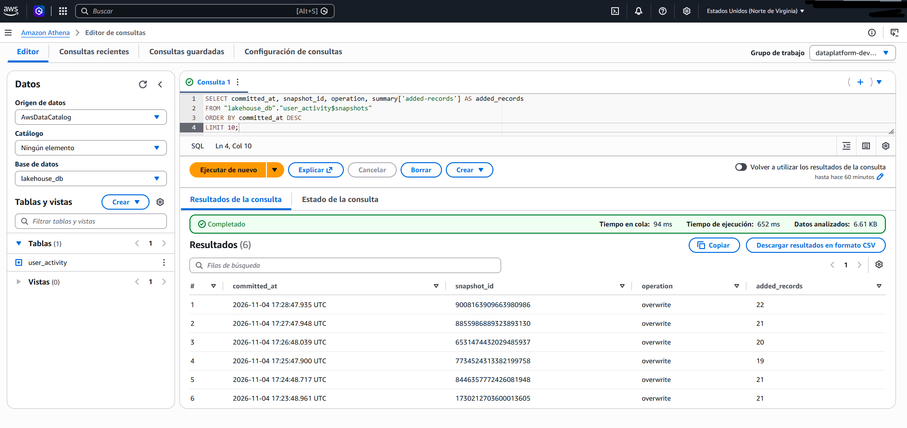

**Lectura:**

- **6 snapshots, uno cada ~60 s:** coinciden con el intervalo de checkpoint de Flink (el `IcebergSink` commitea al completar cada checkpoint) y con los `metadata.json` `00001`–`00006` de S3 (14:23:50 → 14:28:49 en hora local = 17:23:48 → 17:28:47 UTC).
- **Los `snapshot_id` son los mismos que nombran los `snap-<id>-….avro`** del listado de S3: la manifest list de cada snapshot.
- **`operation = overwrite`** (no `append`): con `upsert(true)` y `equalityFieldColumns(user_id, window_start)` cada commit escribe filas nuevas **y** *equality deletes* que invalidan la versión anterior de esa clave. Es Iceberg v2 en modo merge-on-read.
- **`added_records` ≈ 20 por commit:** una fila por cada uno de los 20 usuarios simulados por ventana, más las re-emisiones por eventos tardíos.

Cada fila de `$snapshots` es un checkpoint de Flink que commiteó, con commits cada ~60 s y sin errores de concurrencia.

### Costos y limpieza

El bucket del Lakehouse y el workgroup de Athena tienen `force_destroy`, así que `terraform destroy` los elimina aunque contengan datos y versiones. Athena cobra por datos escaneados: con el particionado por día y el volumen de esta prueba, son centavos.

## Pre-entrega 6 — Analítica in-stream con Amazon Redshift (Streaming Ingestion)

Se agrega una capa de **consulta analítica de baja latencia**: Redshift Serverless consume el Kinesis Data Stream **directamente** (Redshift Streaming Ingestion, sin staging en S3) y, en la misma sesión SQL, lee la tabla **Iceberg** del Lakehouse a través del Glue Data Catalog.

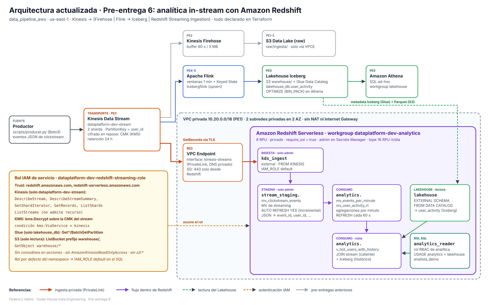

```
                       ┌──► Firehose ──► S3 Data Lake (raw)                    [PE2]
Productor ──► Kinesis ─┼──► Flink ──► Iceberg (S3 + Glue) ──► Athena            [PE4-5]
 (clickstream) (KMS)   └──► Redshift Streaming Ingestion                        [PE6]
                              stream_staging.mv_clickstream_events (AUTO REFRESH)
                                   └──► analytics.mv_* (agregaciones por minuto)
                                                 │ JOIN (misma sesión SQL)
                              lakehouse.user_activity ◄── external schema (Glue / Iceberg)
```

### Infraestructura (`infra/modules/redshift/`)

| Recurso | Configuración | Por qué |
|---|---|---|
| `aws_redshiftserverless_namespace` | base `analytics`, admin `rs_admin` con **contraseña gestionada por Secrets Manager**, logs de usuario/conexión/actividad | Sin secretos en el código ni en el tfstate |
| `aws_redshiftserverless_workgroup` | 8 RPU base, subredes **privadas** de la PE1 (2 AZ), `publicly_accessible = false`, `require_ssl = true` | Sin exposición a Internet y TLS obligatorio para clientes SQL |
| `aws_vpc_endpoint` (Interface, `kinesis-streams`) | DNS privado, en las subredes privadas, SG que solo admite 443 desde Redshift | La VPC no tiene NAT ni IGW: la ingesta viaja por PrivateLink, nunca por Internet |
| `aws_iam_role` `…-redshift-streaming-role` | Trust: `redshift.amazonaws.com` y `redshift-serverless.amazonaws.com`. Permisos: `kinesis:DescribeStream`, `DescribeStreamSummary`, `GetShardIterator`, `GetRecords`, `ListShards` **sobre un único stream**; `kms:Decrypt` sobre **su** CMK (condición `kms:ViaService`); Glue de solo lectura sobre `lakehouse_db`; S3 `GetObject` solo en `warehouse/*` | Mínimo privilegio, sin comodines en acciones; nada de `AmazonKinesisReadOnlyAccess` ni `s3:*` |
| `aws_redshiftserverless_usage_limit` | 16 RPU-horas por día → `deactivate` | Tope de costo si algo queda corriendo |

El rol queda como **rol IAM por defecto** del namespace, así que el SQL usa `IAM_ROLE default`: autenticación IAM entre servicios sin ARNs ni credenciales en el script.

### Modelo de datos en Redshift (`sql/redshift/pre-entrega-6.sql`)

| Esquema | Objeto | Acceso |
|---|---|---|
| `kds_ingest` (externo, `FROM KINESIS`) | el stream como objeto de Redshift | solo administrador |
| `stream_staging` | `mv_clickstream_events`: MV de streaming, `AUTO REFRESH YES`, parseo JSON de `event_id`, `user_id`, `event_type`, `page`, `event_ts` + metadatos de Kinesis | solo administrador (datos crudos) |
| `analytics` | `mv_events_per_minute`, `mv_user_activity_rt` (mismo grano que la tabla Iceberg), `v_hot_users_with_history` (JOIN stream + Iceberg) | rol `analytics_reader` |
| `lakehouse` (externo, `FROM DATA CATALOG`) | `user_activity` (Iceberg) | rol `analytics_reader` (lectura) |

Decisiones:

- **MV de streaming con lógica mínima:** solo extrae texto con `json_extract_path_text(..., true)` y filtra con `CAN_JSON_PARSE`. Un error de casteo dentro de una MV de streaming bloquea la ingesta; los casteos (timestamp del evento) se hacen en la capa `analytics`. Es la protección contra *schema drift*.
- **Refresco en dos niveles:** la MV de streaming se refresca sola y en forma incremental (solo lee desde el último sequence number de cada shard). Las agregaciones se refrescan cada 60 s (trade-off latencia/cómputo). `mv_user_activity_rt` se recalcula completa porque el cast de texto a `TIMESTAMP` no es incrementalmente mantenible; se acepta para no castear dentro de la MV de streaming.
- **Resultados:** lag de ingesta de 0-2 s para tráfico nuevo; la reconciliación Redshift (stream) vs. Flink (Iceberg) por usuario y minuto da `diff = 0`.
- **Iceberg y equality deletes:** Flink escribe en modo upsert (delete files de igualdad). Antes de leer el histórico desde Redshift se compacta la tabla con `OPTIMIZE … REWRITE DATA USING BIN_PACK` en Athena, que aplica los deletes y deja archivos Parquet limpios.

### Despliegue y prueba

```powershell
# 1. Infraestructura (incluye Redshift). La creación de la app MSF sigue
#    rechazada por la verificación de cuenta (ver PE4): el resto se crea igual.
cd infra/environments/dev; terraform apply; cd ../../..

# 2. Histórico en Iceberg: el job de Flink local (PE5) unos minutos
docker compose -f app/local/docker-compose.yml up -d
docker compose -f app/local/docker-compose.yml exec jobmanager flink run -d -p 2 /job/clickstream-processor-1.0.jar
python scripts/producer.py --stream-name dataplatform-dev-stream --count 600 --users 20 --interval 0.5
#    esperar ~2 min (2 checkpoints) para que Flink commitee el último snapshot
docker compose -f app/local/docker-compose.yml down
#    Athena: OPTIMIZE lakehouse_db.user_activity REWRITE DATA USING BIN_PACK;

# 3. Redshift: Query Editor v2 → workgroup dataplatform-dev-analytics → base analytics
#    → ejecutar sql/redshift/pre-entrega-6.sql por secciones

# 4. Datos calientes: nuevo tráfico mientras se consulta
python scripts/producer.py --stream-name dataplatform-dev-stream --count 300 --users 20 --interval 0.5
```

### Evidencia

**1. Streaming Ingestion:** eventos de Kinesis en `stream_staging.mv_clickstream_events`, con los campos JSON ya convertidos en columnas y los metadatos de Kinesis.

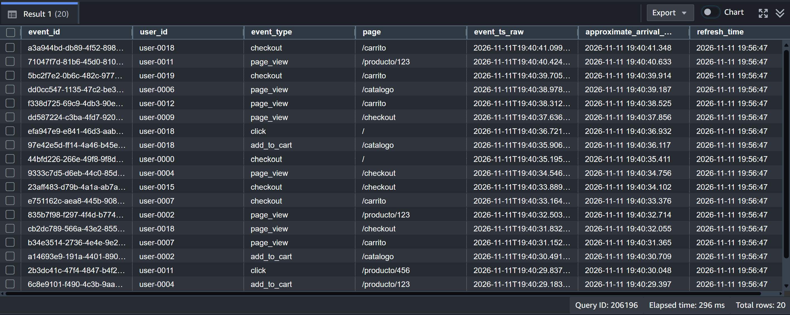

**2. Agregación de tiempo real:** `analytics.mv_events_per_minute`.

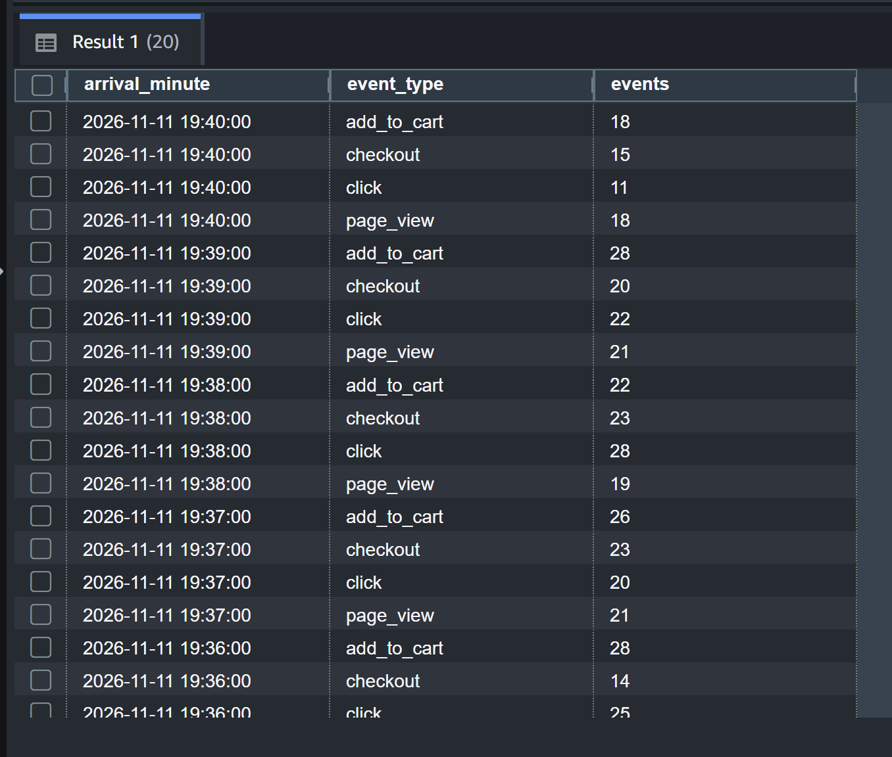

**3. Iceberg leído desde Redshift:** `lakehouse.user_activity` a través del external schema sobre Glue.

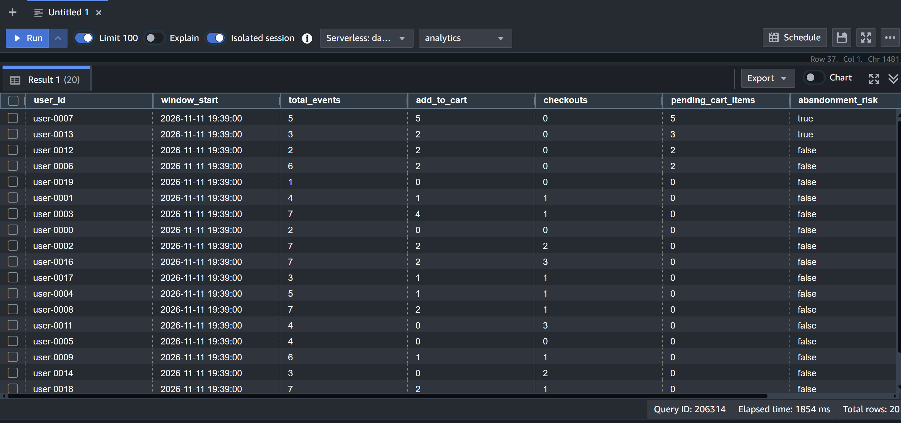

**4. JOIN stream + histórico en la misma sesión:** `retarget_now = true` marca a los usuarios con el carrito abierto ahora y con alertas de abandono en el histórico.

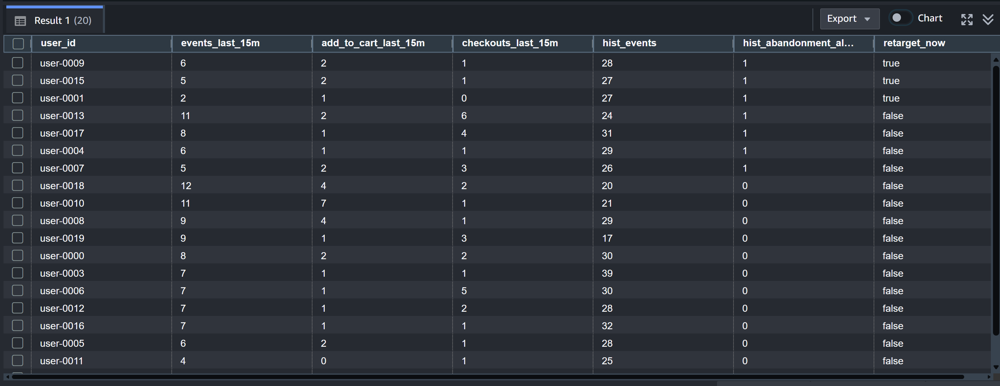

**5. Reconciliación:** el conteo de Redshift (stream) y el de Flink (Iceberg) por usuario y minuto coinciden: `diff = 0`.

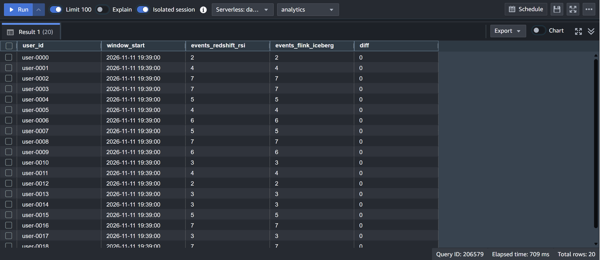

**6. RBAC:** `analista_demo` (rol `analytics_reader`) consulta `analytics`, pero recibe `permission denied for schema stream_staging`.

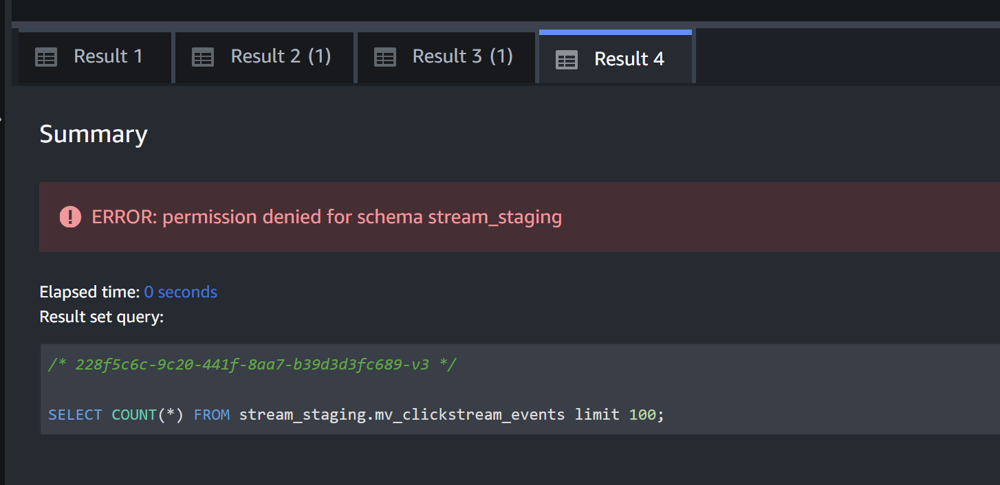

**7. Lag de ingesta:** el tráfico nuevo está disponible en 0-2 s. Los minutos anteriores a la creación de la MV muestran la carga inicial desde la retención del stream.

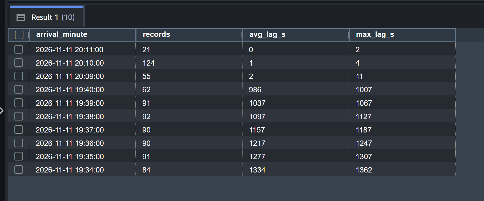

**8. Metadatos de Iceberg en S3:** un `metadata.json` por commit de Flink, más manifest lists y manifests.

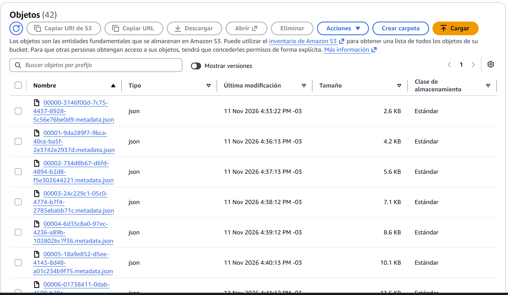

El documento completo de la entrega es `CheckPoint_Redshift_Valino_Federico.pdf` (diagrama, script SQL y capturas).

### Costos y limpieza

Redshift Serverless cobra por RPU-hora solo mientras procesa (con mínimo de 60 s por consulta); el refresco automático de la MV de streaming consume cómputo mientras entra tráfico. El límite diario de 16 RPU-horas acota el peor caso. El endpoint de interfaz de Kinesis cobra por hora y por AZ. Al terminar: `terraform destroy`.

## Cómo extender a prod

1. Cuenta AWS separada para prod (aislamiento total del state y de los permisos).
2. Ejecutar el mismo `bootstrap/` con credenciales de la cuenta prod (ej. `AWS_PROFILE=prod`) para crear su propio bucket y tabla.
3. Crear `environments/prod/` copiando `environments/dev/`, con su `terraform.tfvars` (ej. otro `vpc_cidr`, `az_count = 3`) y su `backend.hcl` (`key = "prod/terraform.tfstate"`).
4. Los módulos no se modifican.

## Validación de calidad

```bash
terraform fmt -recursive -check
terraform validate
tflint --recursive        # opcional
```

## Decisiones, limitaciones y próximos pasos

- **Locking con DynamoDB:** la consigna lo exige. Terraform ≥ 1.11 marca `dynamodb_table` como deprecado en favor del lock nativo de S3 (`use_lockfile = true`); el `init` muestra ese warning. Migrar no cambia el resto del diseño.
- **Cifrado SSE-S3 (AES256):** cumple el requisito de cifrado del lado del servidor. En prod se usaría SSE-KMS con una CMK propia para controlar y auditar el uso de la llave.
- **Rol de ejecución acotado a la consigna:** cuando la Lambda exista (próxima entrega) necesitará además permisos de CloudWatch Logs y de creación de interfaces de red en la VPC. Se agregarán como una política adicional sobre el mismo rol (output `exec_role_name`), sin ampliar la política de S3.
- **Acceso a objetos solo vía VPC Endpoint:** subir archivos al Data Lake desde fuera de la VPC (ej. `aws s3 cp` desde una laptop) devuelve `AccessDenied` por diseño. Los servicios administrados que escriben desde fuera de la VPC se exceptúan de forma explícita por ARN de rol (en la pre-entrega 2, el rol de Firehose).
- **Service roles vs. service-linked roles:** los roles de este repositorio son *service roles* (los define el usuario y los asume un servicio). Los *service-linked roles* los crea y gestiona AWS.

## Limpieza

```bash
cd infra/environments/dev
terraform destroy          # elimina red, Data Lake, roles, stream, Firehose y alarmas
```

El bootstrap tiene `prevent_destroy` en el bucket del state para evitar borrar por error la "memoria" de la infraestructura. Se elimina solo de forma deliberada, quitando esa protección.